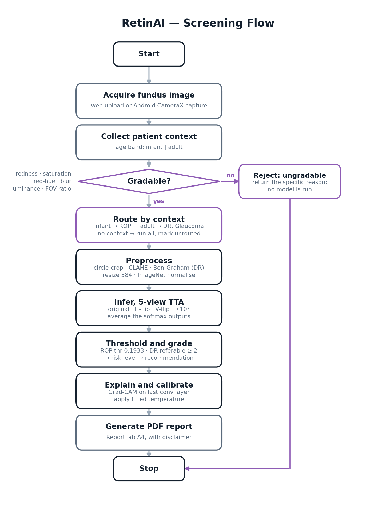
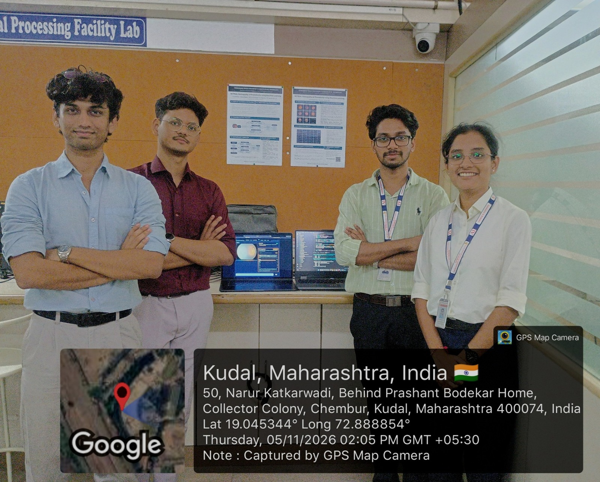
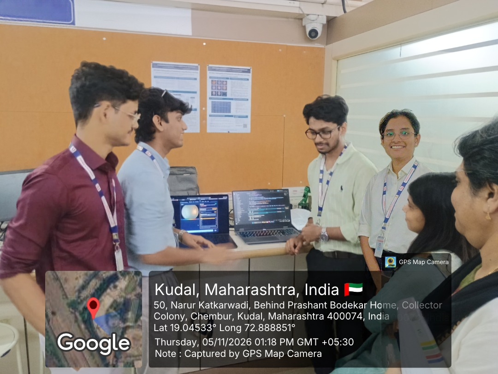

# BE Capstone Project

## Project Title

**RetinAI: Retinopathy of Prematurity using Machine Learning**
*Four-class ROP staging with a LoRA-adapted retinal foundation model (RETFound-DINOv2)*

[](https://www.python.org/)
[](https://pytorch.org/)
[](https://flask.palletsprojects.com/)

RetinAI classifies a colour fundus photograph of a premature infant into one of **four classes**:
**Normal, Stage 1, Stage 2, Stage 3**. Advanced disease (**Stage 4/5 and AP-ROP**) is grouped into
**Stage 3**. The model is **RETFound-DINOv2 (ViT-Large, about 304M parameters, frozen) adapted with
Low-Rank Adaptation (LoRA)**, so only a few million adapter parameters are trained. This is the only
model kept in this repository. CNN and classical-machine-learning results are retained as
baselines for comparison.

> `[CONFIRM]` The paper draft says Stage 4/5 and AP-ROP were *excluded* from the 3,141-image set.
> If the reported numbers were computed with those images excluded rather than merged, either
> re-count and retrain with the merged labels, or reword this label policy. See
> [Label scheme](#label-scheme).

**This is not a medical device.** It is a research and education prototype built for a final-year
capstone project. It has no regulatory clearance and was never prospectively validated, so it must
not be used for real diagnosis. A qualified clinician confirms every finding.

**Project evolution.** The project began as a three-disease screener (diabetic retinopathy, ROP,
glaucoma) and later became a six-class ROP stager (EfficientNetV2-S, ResNet50 and a DINOv2 ViT-S/14
ensemble). Those models and the DR and glaucoma code were retired and removed from this repository.
The earlier work stays in the team's private development repository. This README documents only the
four-class RETFound-DINOv2 LoRA system and its baselines.

---

## Table of Contents

1. [Team Details](#team-details)
2. [Guide Details](#guide-details)
3. [Problem Statement](#problem-statement)
4. [Abstract](#abstract)
5. [Objectives](#objectives)
6. [Scope of the Project](#scope-of-the-project)
7. [Existing System](#existing-system)
8. [Proposed System](#proposed-system)
9. [System Architecture](#system-architecture)
10. [Hardware Requirements](#hardware-requirements)
11. [Software Requirements](#software-requirements)
12. [Technologies Used](#technologies-used)
13. [Methodology](#methodology)
14. [Project Timeline](#project-timeline)
15. [Weekly Progress Updates](#weekly-progress-updates)
16. [Design Files](#design-files)
17. [Circuit Diagram](#circuit-diagram)
18. [Flowchart / Algorithm](#flowchart--algorithm)
19. [Implementation Details](#implementation-details)
20. [Code Structure](#code-structure)
21. [How to Run the Project](#how-to-run-the-project)
22. [Testing and Results](#testing-and-results)
23. [Result Images / Videos](#result-images--videos)
24. [Applications](#applications)
25. [Advantages](#advantages)
26. [Limitations](#limitations)
27. [Future Scope](#future-scope)
28. [Research Paper / Publication](#research-paper--publication)
29. [References](#references)
30. [Repository Update Guidelines](#repository-update-guidelines)
31. [Declaration](#declaration)
32. [License](#license)

---

## Team Details

| Sr. No. | Name of Student | Roll No. | Branch | Email ID | GitHub ID |
|---|---|---|---|---|---|
| 1 | Rutuja Bait | 36 | Automation and Robotics | 2023.rutuja.bait@ves.ac.in | rutujabait |
| 2 | Pravar Rangnekar | 25 | Automation and Robotics | 2023.pravar.rangnekar@ves.ac.in | PravarRangnekar |
| 3 | Yash Shengale | 63 | Automation and Robotics | 2023.yash.shengale@ves.ac.in | yashshengale |
| 4 | Praharsh Nagpure | 16 | Automation and Robotics | 2023.praharsh.nagpure@ves.ac.in | Coldbari |

---

## Guide Details

**Project Guide:** Mrs. Amudha Senthilkumar
**Department:** Automation and Robotics
**Institute:** Vivekanand Education Society's Institute of Technology (VESIT), Chembur, Mumbai (University of Mumbai)

---

## Problem Statement

> The aim of this project is to design and develop an automated four-class staging system for
> Retinopathy of Prematurity (Normal, Stage 1, Stage 2, Stage 3) from colour fundus images, using a
> parameter-efficient LoRA-adapted retinal foundation model (RETFound-DINOv2), and to compare it
> fairly with classical machine learning and ImageNet-pretrained CNNs under one common protocol.

ROP is a vascular disorder of the developing retina in premature infants. If severe disease is not
identified and managed appropriately, it can lead to permanent visual impairment [1]. Screening
relies on examining fundus images for vascular abnormalities and judging their severity, which
needs specialised expertise. Disagreement between expert graders is a recognised difficulty, and
image quality affects both manual and automated assessment [2], [3]. Most published ROP studies
address isolated tasks such as presence of disease or Plus disease, so their results are not
directly comparable with full stage classification [3].

---

## Abstract

Retinopathy of Prematurity (ROP) is a vascular disorder of the developing retina in premature
infants that can cause permanent blindness if advanced disease is missed. Screening depends on
specialists staging fundus photographs, which is slow, subjective and scarce. This project builds a
four-class ROP staging system (Normal, Stage 1, Stage 2, Stage 3, with Stage 4/5 and AP-ROP grouped
into Stage 3) from colour fundus images. Using 3,141 de-duplicated images from two public sources
(Zhao et al. 2024 and ROP-VL), CLAHE preprocessing and one stratified 80/10/10 split, we compare
classical machine learning on handcrafted features, six ImageNet CNNs and a retinal foundation
model, RETFound-DINOv2 (ViT-Large, about 304M parameters, frozen), adapted with Low-Rank
Adaptation (LoRA) while training only 2.4M to 12.6M parameters on a 6 GB laptop GPU. The retained
model is the LoRA-adapted RETFound-DINOv2. On the 315-image test set, single LoRA runs reach up to
83.2% accuracy (QWK up to 0.900), comparable to the best CNN (ResNeSt50d, 83.5%, QWK 0.898), and a
top-3 ensemble reaches 84.4%. Confidence intervals overlap heavily and the three seeds of one
configuration differ by up to 4.4 accuracy points, so the leading models are statistically tied.
Results come from a single photo-level split without external validation: they show feasibility,
not clinical readiness.

---

## Objectives

1. To study ROP staging, the clinical background and the published machine-learning approaches.
2. To build a reproducible pipeline: duplicate removal, CLAHE preprocessing, stratified splitting
   and validation-based model selection.
3. To compare classical handcrafted-feature classifiers, six ImageNet-pretrained CNNs, a top-3 CNN
   ensemble, a fully fine-tuned DINOv2 ViT-B/14 and LoRA-adapted RETFound-DINOv2.
4. To study how LoRA placement, rank, learning rate, token pooling, drop-path and input resolution
   affect RETFound-DINOv2.
5. To report statistical uncertainty honestly (Wilson intervals, seed-to-seed spread).
6. To make predictions explainable and deliver them through a simple application with a PDF report
   `[CONFIRM: the app serves the RETFound LoRA model]`.
7. To document the work with its limitations and prepare it for publication.

---

## Scope of the Project

### Label scheme

| Class | Description |
|---|---|
| Normal | No ROP |
| Stage 1 | Thin demarcation line |
| Stage 2 | Raised ridge |
| Stage 3 | Extraretinal fibrovascular proliferation. **Also contains Stage 4/5 (partial or total detachment) and AP-ROP (aggressive posterior ROP)**, grouped as advanced disease |

Grouping Stage 4/5 and AP-ROP into Stage 3 is a simplification: the class then mixes different
clinical situations, so a "Stage 3" prediction means "advanced ROP", not only Stage 3 proper.
`[CONFIRM]` The paper draft (Section II-A and Limitations) says these classes were excluded, not
merged. Align the data counts and the paper text with the final decision.

### In scope

- Four-class ROP staging from a single colour fundus photograph.
- Data cleaning (exact duplicates), CLAHE, one stratified 80/10/10 split.
- Three model families: classical ML, ImageNet CNNs (plus a top-3 ensemble), and foundation models
  (DINOv2 ViT-B/14 full fine-tune, RETFound-DINOv2 + LoRA).
- A LoRA sweep over placement, rank, learning rate, pooling, drop-path and resolution.
- Accuracy, balanced accuracy, macro-F1, QWK and one-vs-rest AUC, with Wilson intervals.

### Out of scope

- Regulatory clearance, clinical trials or prospective validation.
- Autonomous diagnosis: this is decision support and a clinician confirms every result.
- External-hospital validation, calibration and robustness testing (listed under future work).
- Fundus camera hardware.
- Diabetic retinopathy, glaucoma and six-class staging (earlier phases, removed).

---

## Existing System

| Existing approach | How it works | Limitations |
|---|---|---|
| Bedside examination by an ophthalmologist | A specialist examines each at-risk infant | Needs scarce expertise; graders disagree on ROP diagnosis [2], [3] |
| Digital fundus imaging (RetCam-class) and tele-reading | Images captured locally, read remotely [11], [12] | Documents the retina but a human still reads every image |
| Published AI models for ROP | CNNs for detection, Plus disease or severity [3]–[7]; ROP-VL with a vision-language model [13] | Mostly detection or Plus disease on single-centre cohorts (VGG19 96% and 98.82% on 210 infants [3]; EK-ROP-Net 94.26% accuracy, Kappa 91.40% [13]); not comparable with four-class staging |

---

## Proposed System

**Main idea.** Adapt a retinal foundation model to four-class ROP staging with LoRA, so that the
large pretrained backbone stays frozen and only small adapters and a four-unit head are trained.

**How it works.**

1. A fundus image is cropped, enhanced with CLAHE on the lightness channel and normalised.
2. RETFound-DINOv2 (frozen ViT-Large, 24 blocks, width 1024) extracts patch tokens.
3. LoRA adapters in the attention (and MLP) layers adjust the features; a four-class head gives
   Normal / Stage 1 / Stage 2 / Stage 3 probabilities via softmax, and the prediction is the argmax.
4. The result is shown with an explanation and a PDF report `[CONFIRM: Grad-CAM and PDF on the LoRA model]`.

**Expected benefits.** A 304M-parameter retinal model adapted on a 6 GB consumer GPU, with a few
million trainable parameters per task, and results stated with their statistical uncertainty.

---

## System Architecture

> `[CONFIRM / TO DO]` Redraw `images/system_architecture.png` and `images/flowchart.png` for this
> four-class pipeline (the old versions show the earlier multi-disease system).

```
 Zhao et al. 2024 (Figshare) ──┐
 ROP-VL (Chen et al.)  ────────┴─► Clean: corrupt check + exact-duplicate removal (3,318 → 3,141)
                                   │
                                   ▼
                      CLAHE (lightness channel), resize 256 → ~224 px, normalise
                                   │
                    Stratified split 80/10/10 (seed 42): 2,512 / 314 / 315
                                   │
        ┌──────────────────────────┼───────────────────────────────┐
        ▼                          ▼                               ▼
 Classical ML                  ImageNet CNNs               RETFound-DINOv2 + LoRA  (retained model)
 (colour, LBP, GLCM,           (6 backbones + top-3        frozen ViT-L backbone, adapters + head
  HOG, Frangi → classifiers)    ensemble)                  trained; LoRA sweep
        └──────────────────────────┼───────────────────────────────┘
                                   ▼
            Validation macro-F1 selection → test metrics on 315 images
            (accuracy, balanced accuracy, macro-F1, QWK, AUC, Wilson CI)
                                   ▼
            RETFound LoRA → web app: stage, explanation, PDF report  [CONFIRM]
```

---

## Hardware Requirements

This is a software and machine-learning project. No circuit was designed and no microcontroller
programmed. The table lists the compute used. It is filled in because the template asks for it.

| Sr. No. | Component | Specification | Quantity | Purpose |
|---|---|---|---|---|
| 1 | Laptop GPU | NVIDIA RTX 4050, 6 GB VRAM, bfloat16 mixed precision | 1 | Training and evaluating all models |
| 2 | Demo / development machine | `[CONFIRM: model and RAM]` | 1 | Running the local web app |
| 3 | Fundus camera (third-party) | RetCam-class contact camera, not built by us | n/a | Origin of the public dataset images |

---

## Software Requirements

| Sr. No. | Software / Tool | Version | Purpose |
|---|---|---|---|
| 1 | Python | 3.14 (training); 3.11+ (app) `[CONFIRM]` | Main language |
| 2 | PyTorch | 2.14.1 (CUDA 12.6) | Models, training, inference |
| 3 | timm | 1.0.31 | CNN and DINOv2/ViT backbones |
| 4 | scikit-learn | 1.9.1 | Metrics, QWK, classical classifiers |
| 5 | OpenCV | 5.0 | CLAHE, black-border crop, Frangi/HOG features |
| 6 | pandas | 3.1 | Tables and result files |
| 7 | LightGBM, CatBoost, XGBoost | latest | Classical-ML classifiers |
| 8 | Flask, ReportLab | 3.x, 4.x | Web app and PDF report `[CONFIRM]` |
| 9 | Pretrained checkpoint | `RETFound_dinov2_meh.pth` (key `teacher`; 342 tensors loaded, 0 missing, 0 unexpected) | RETFound-DINOv2 weights |

---

## Technologies Used

* **Foundation model:** RETFound-DINOv2 (ViT-Large, patch size 14, 24 blocks, about 304M parameters)
  with Low-Rank Adaptation (LoRA); DINOv2 ViT-B/14 full fine-tune as a reference
* **CNN baselines:** ResNeSt50d, DenseNet121, EfficientNet-B2, ResNet50, MobileNetV3-Large,
  ConvNeXt-Tiny, and a soft ensemble of the top three
* **Classical ML:** colour statistics, LBP, GLCM, HOG and Frangi vessel features into SVM, LightGBM,
  CatBoost, ExtraTrees, XGBoost, Random Forest and others
* **Image processing:** CLAHE, black-border cropping, resizing
* **Metrics and statistics:** accuracy, balanced accuracy, macro-F1, QWK, one-vs-rest AUC, Wilson
  95% intervals
* **Training:** bfloat16 mixed precision, one-change-at-a-time LoRA sweep
* **Web:** Flask, ReportLab `[CONFIRM]`

---

## Methodology

1. **Literature survey.** ROP background and stages, classical and deep-learning approaches,
   foundation models and ROP datasets.
2. **Problem identification.** Four-class staging is under-studied compared with detection or Plus
   disease, and comparisons across model families rarely share one split and one metric set.
3. **Requirement analysis.** One image in, one of four stages out; one common data split and metric
   set; trainable on a 6 GB GPU.
4. **Data preparation.** Merge Zhao et al. 2024 (1,438 images) and ROP-VL (1,880 images) = 3,318;
   remove 177 exact duplicates (57 Normal, 17 Stage 1, 37 Stage 2, 66 Stage 3) = 3,141.
5. **Preprocessing.** CLAHE on the lightness channel, stored at 256 px and fed at about 224 px.
6. **Split.** One stratified 80/10/10 split (seed 42), reused for every model.
7. **Training and selection.** Train each model on the training set, select by validation macro-F1.
8. **LoRA sweep.** Change one setting at a time (learning rate, pooling, placement, rank,
   drop-path, resolution) in ten-epoch probes, then final runs.
9. **Evaluation.** Test metrics on 315 images and Wilson intervals.
10. **Integration and documentation.** Application, project report (black book) and paper.

---

## Project Timeline

Weeks are counted from Monday 08 Jun 2026 (Week 1). Today is in Week 22 (02 to 08 Nov).

| Week | Task Planned | Status |
|---|---|---|
| Week 1 (08 Jun) | Problem finalisation, baseline model | Completed |
| Week 2 (15 Jun) | Literature survey, dataset acquisition | Completed |
| Week 3 (22 Jun) | Training framework, architecture comparison | Completed |
| Week 4 (29 Jun) | Further model experiments, web app rebuild | Completed |
| Week 5–7 (06–26 Jul) | Presentation preparation (no repository activity) | Completed |
| Week 8–11 (27 Jul – 23 Aug) | Audits, ROP staging experiments, verification | Completed |
| Week 12–15 (24 Aug – 20 Sep) | Paper draft, demo hardening, preprocessing study, dataset packaging | Completed |
| Week 16–18 (21 Sep – 11 Oct) | Post-proposal review prepared and presented | Completed |
| Week 19–21 (12 Oct – 01 Nov) | Review feedback, model comparison rounds | Completed |
| `[CONFIRM]` | Four-class experiments: CNNs, classical ML, RETFound-DINOv2 LoRA sweep | `[CONFIRM: dates]` |
| Week 22 (02–08 Nov) | Decision to keep only RETFound-DINOv2 LoRA; README, paper and report reconciled; repository cleanup | In progress |
| Next | Finish and submit the paper; complete the project report; publish LoRA adapter weights | Planned |

---

## Weekly Progress Updates

Condensed from the development repository's history. Commit counts are shown because the full
history is in a private repository. `[CONFIRM]` The template asks for a commit link per week.

| Week | Date | Work Completed | Issues / Challenges | Commits |
|---|---|---|---|---|
| 1 | 08 Jun 2026 | Baseline unified ROP+DR model and Flask app | Shared backbone forced a compromise across two diseases | 2 |
| 2 | 15–21 Jun | Literature survey, dataset acquisition, Kaggle setup | Baseline plateaued | 0 |
| 3 | 22–28 Jun | Config-driven training framework; architecture comparison; multi-disease app | GPU compatibility and memory limits on Kaggle | 10 |
| 4 | 29 Jun–05 Jul | Further model experiments; web app and model card | One model generalised poorly to a new source | 7 |
| 5–7 | 06–26 Jul | Presentation and dataset survey | No repository activity (presentation and exam period) | 0 |
| 8 | 27 Jul–02 Aug | Statistics overhaul and confound audits | A headline score was partly camera recognition; a patient-data exposure risk found | 21 |
| 9 | 03–09 Aug | Further audits; ROP staging corpus consolidated | Patient photographs exposed in a hosted app; removed | 43 |
| 10 | 10–16 Aug | Six-class staging experiments with patient-grouped CV; hosted app deleted 14 Aug to purge patient images from git history | An early single-fold result did not hold across 5-fold CV | 24 |
| 11 | 17–23 Aug | Every published claim re-verified; held-out test run once; repository narrowed to ROP | A healthy retina was flagged positive by the old model | 16 |
| 12 | 24–30 Aug | First paper draft; co-author approached for label adjudication | No adjudication agreement yet | 0 |
| 13–15 | 31 Aug–20 Sep | Demo hardening; preprocessing investigation (negative result); dataset packaging | Illumination correction did not remove the device signature | 5 |
| 16 | 21 Sep | Log book brought current | Four-week update gap recorded | 2 |
| 16–19 | 22 Sep–17 Oct | Post-proposal review prepared and presented; feedback: change the model and approach | Thin eye-level data | 9 |
| 19–22 | 18 Oct–05 Nov | Model comparison rounds including the RETFound-DINOv2 LoRA model | Models tied; seed variation large | 72 |
| 22 | 06–08 Nov | Decision: four classes, keep only RETFound-DINOv2 LoRA; README, paper and black book reconciled against the result files | Classical ML scored on a different test set; 280-px runs were finished but reported as unfinished | 0 so far |

---

## Design Files

| File Type | File Name / Link | Description |
|---|---|---|
| System architecture | [images/system_architecture.png](images/system_architecture.png) | `[CONFIRM: redraw for four-class pipeline]` |
| Flowchart | [images/flowchart.png](images/flowchart.png) | `[CONFIRM: redraw]` |
| Results: foundation models | `results/fm_results.csv` `[CONFIRM: path]` | 19 rows: 12 RETFound-LoRA runs, 6 CNNs, one ensemble |
| Results: CNNs | `results/cnn_results.csv` `[CONFIRM: path]` | 6 CNNs and their top-3 ensemble |
| Results: classical ML | `results/results.csv` `[CONFIRM: path]` | 12 classical classifiers |
| Paper | `docs/` `[CONFIRM: path]` | *Four-Class ROP Staging from Fundus Images* (IEEE-format draft) |
| Project report | `docs/` `[CONFIRM: path]` | BE project report (black book) |
| CAD / Circuit / PCB / Simulation | Not applicable | Software-only project |

---

## Circuit Diagram

Not applicable. RetinAI is a software and machine-learning system with no custom electronics.

---

## Flowchart / Algorithm



### Algorithm

```
1.  Start
2.  Receive a colour fundus photograph
3.  Check the file (corrupt / not an image) -> reject with a reason
4.  Circle-crop / black-border crop; CLAHE on the lightness channel
5.  Resize and normalise (about 224 px; 280 px for the img280 runs)   [CONFIRM: served resolution]
6.  Run RETFound-DINOv2 (frozen ViT-L) with the trained LoRA adapters
7.  Four-unit head -> softmax -> argmax
      Normal | Stage 1 | Stage 2 | Stage 3 (includes Stage 4/5 and AP-ROP)
8.  Explain the result (Grad-CAM heatmap)                              [CONFIRM]
9.  Generate the PDF report with the disclaimer                        [CONFIRM]
10. Display the result
11. Stop
```

---

## Implementation Details

### Hardware Implementation

Not applicable: no custom hardware. All models were trained on one NVIDIA RTX 4050 (6 GB) with
bfloat16 mixed precision.

### Software Implementation

**Data.** 3,318 images (Zhao et al. 2024: 1,438; ROP-VL: 1,880). No corrupt images; 177 exact
duplicates removed (visually near-identical frames of one eye are *not* detected). Split once
(stratified, seed 42): training 2,512, validation 314, test 315.

| Split | Normal | Stage 1 | Stage 2 | Stage 3 | Total |
|---|---|---|---|---|---|
| Train | 687 | 515 | 651 | 659 | 2,512 |
| Validation | 86 | 65 | 81 | 82 | 314 |
| Test | 86 | 64 | 82 | 83 | 315 |
| Total | 859 | 644 | 814 | 824 | 3,141 |

The two sources differ in class balance (Normal is 43% of Zhao et al. but 16% of ROP-VL; Stage 3 is
17% versus 35%), so a model could use source appearance as a shortcut.

**Preprocessing.** CLAHE on the lightness channel; images stored at 256 px and fed at about 224 px;
classical track additionally crops black borders with a grey threshold.

**Classical track.** Colour statistics, LBP, GLCM, HOG and Frangi vessel features into 12
classifiers.

**CNN track.** Six timm backbones fine-tuned from ImageNet weights (final layer replaced by a
four-way layer, all layers trained) and a soft ensemble of EfficientNet-B2, ResNet50 and DenseNet121.

**RETFound-DINOv2 + LoRA (retained model).** The `teacher` weights of `RETFound_dinov2_meh.pth` are
loaded into a ViT-Large encoder (patch 14, 24 blocks). The backbone is frozen. LoRA adapters
(W = W0 + BA, rank r much smaller than the layer width) are inserted into the query, key, value and
projection layers (and, in MLP variants, the fully connected layers); layer-wise learning-rate decay
is not used. Only the adapters and the four-class head are trained.

| Variant | LoRA layers | Placement | Rank | Trainable parameters | Total |
|---|---|---|---|---|---|
| Base | 48 | Attention | 16 | 2.37M | 305.6M |
| MLP | 96 | Attention + MLP | 16 | 6.30M | 309.5M |
| MLP r32 | 96 | Attention + MLP | 32 | 12.59M | 315.8M |
| V2 | 96 | Attention + MLP | 32 | 12.60M | 315.8M |

**Training schedule.** First LoRA run: up to 30 epochs at lr 4e-4, stopped at epoch 20. V2: up to 50
epochs at lr 1e-3, stopped at epoch 20. Probes and final sweep: 10 epochs, lr 2e-4 to 8e-4. Epoch
time on the RTX 4050: about 92 s (attention-only), 115 s (attention+MLP), 120 s (V2), some runs
300–400 s. Batch size, optimiser, weight decay, LoRA alpha and dropout, augmentation and loss
function were not preserved in the experiment logs `[CONFIRM: add them from the code if available]`.

**Serving.** `[CONFIRM: the Flask app must load the RETFound-DINOv2 LoRA adapters as the primary
model; today the app's primary model is an older one and RETFound appears only as a comparison
panel.]`

---

## Code Structure

Target structure after the cleanup (old models, DR and glaucoma code removed).
`[CONFIRM: match the real folder names; the report names three packages rop_ml, rop_cnn, rop_foundation]`

```text
RetinAI_BE_Project_2026_2027/
│
├── README.md
├── requirements.txt
├── data_prep/               ← duplicate removal, CLAHE, stratified split (no images)
├── rop_ml/                  ← classical features and classifiers
├── rop_cnn/                 ← six CNNs and the top-3 ensemble
├── rop_foundation/          ← DINOv2 and RETFound-DINOv2 + LoRA
├── webapp/                  ← Flask app serving the RETFound LoRA model
├── results/
│   ├── cnn_results.csv
│   ├── results.csv          ← classical ML
│   └── fm_results.csv       ← foundation models + CNNs + ensemble
├── images/                  ← architecture, flowchart, result figures
├── docs/                    ← paper, project report, review decks
├── hardware/                ← "not applicable" note
└── geotagged_images/        ← team photographs from the 5 Nov 2026 demonstration
```

**Not in this repository:** patient-level data and image lists, the pretrained RETFound checkpoint
(obtained from its authors under their terms), and the retired earlier models.

---

## How to Run the Project

### Step 1: Clone the Repository

```bash
git clone https://github.com/Coldbari/RetinAI_BE_Project_2026_2027.git
cd RetinAI_BE_Project_2026_2027
```

### Step 2: Install Dependencies

```bash
python -m venv .venv && source .venv/bin/activate      # Windows: .venv\Scripts\activate
pip install -r requirements.txt
```

### Step 3: Get the Model Weights

1. Download the pretrained `RETFound_dinov2_meh.pth` from the RETFound authors [15] and place it in
   `[CONFIRM: folder]`.
2. Download the trained LoRA adapter files `[CONFIRM: not yet published; upload to a model
   repository and put the link here]`.

### Step 4: Run

```bash
python webapp/app.py            # [CONFIRM: command] → http://127.0.0.1:5002
```

Upload a neonatal fundus photograph. Expected output: the predicted class (Normal, Stage 1,
Stage 2 or Stage 3), class probabilities, an explanation and a PDF report `[CONFIRM]`. The output is
decision support only.

---

## Testing and Results

All numbers below are on the fixed **315-image test set** unless stated. Models were selected by
validation macro-F1. Values come from `fm_results.csv`, `cnn_results.csv` and `results.csv`.
Accuracy intervals are 95% Wilson intervals computed from the correct-prediction count (n = 315).

### RETFound-DINOv2 + LoRA runs (retained model)

Run IDs are the names in `fm_results.csv`. `p_` runs look like ten-epoch probes and `final_` runs
like final runs `[CONFIRM: naming]`. Sorted by test accuracy.

| Run | Val F1 | Accuracy | 95% CI | Bal. Acc. | Macro-F1 | QWK | AUC |
|---|---|---|---|---|---|---|---|
| final_mlp_img280_s2 | 0.8457 | 0.8317 | 78.6–86.9 | 0.8267 | 0.8265 | 0.8895 | 0.9514 |
| p_mlp_lr6e4 (paper's headline run) | 0.8294 | 0.8286 | 78.3–86.6 | 0.8253 | 0.8231 | 0.8973 | 0.9576 |
| final_base_s42 | 0.8175 | 0.8254 | 78.0–86.3 | 0.8178 | 0.8181 | 0.9002 | 0.9556 |
| final_mlp_img280_s1 | 0.8409 | 0.8222 | 77.6–86.0 | 0.8182 | 0.8149 | 0.8883 | 0.9523 |
| p_mlp_img280 | 0.8342 | 0.8222 | 77.6–86.0 | 0.8210 | 0.8177 | 0.8747 | 0.9587 |
| p_mlp_r32 | 0.8189 | 0.8159 | 76.9–85.5 | 0.8107 | 0.8099 | 0.8671 | 0.9500 |
| p_mlp_ord | 0.8071 | 0.8063 | 75.9–84.6 | 0.8069 | 0.8031 | 0.8760 | 0.9513 |
| p_mlp_dp1 | 0.8298 | 0.7968 | 74.9–83.8 | 0.7986 | 0.7931 | 0.8606 | 0.9514 |
| p_mlp | 0.8101 | 0.7968 | 74.9–83.8 | 0.7985 | 0.7920 | 0.8624 | 0.9473 |
| final_mlp_img280_s42 | 0.8458 | 0.7873 | 73.9–82.9 | 0.7865 | 0.7785 | 0.8699 | 0.9502 |
| final_mlp_s42 | 0.8161 | 0.7778 | 72.9–82.0 | 0.7635 | 0.7646 | 0.8605 | 0.9477 |
| p_mlp_combo | 0.6227 | 0.6508 | 59.7–70.1 | 0.6620 | 0.6166 | 0.7612 | 0.9000 |
| **ENSEMBLE top-3** `[CONFIRM: members]` | 0.8393 | **0.8444** | 80.0–88.0 | 0.8420 | 0.8386 | 0.8995 | 0.9641 |

Observations:

- **Seed spread.** The three 280-px runs (seeds 42, 1 and 2) score 78.7%, 82.2% and 83.2%: a
  4.4-point range, mean 81.4% accuracy, mean QWK 0.883. The ensemble row (84.4%) is probably the
  average of these three `[CONFIRM]`.
- **MLP adapters help** over attention-only in the early probes, **rank 32 and drop-path do not
  help**, and a combined-changes run (`p_mlp_combo`) and lr 1e-3 with EMA (V2, 70.5%) are clearly
  worse, so learning rate and combined changes matter.
- **Selection.** The paper selects by validation macro-F1. In `fm_results.csv`, `p_mlp_lr6e4` has
  Val F1 0.8294, while five other LoRA runs have a higher Val F1 (0.8458, 0.8457, 0.8409, 0.8342,
  0.8298). `[CONFIRM: which configuration is the retained model, and reconcile with the paper's
  Val F1 of 0.839 for mlp_lr6e4.]`
- Two nominally identical MLP runs in the paper differed by about two accuracy points (0.816 and
  0.797); the seed range above is larger.

### Baselines: ImageNet CNNs and DINOv2 (same 315-image test set)

| Model | Val F1 | Accuracy | 95% CI | Bal. Acc. | Macro-F1 | QWK | AUC |
|---|---|---|---|---|---|---|---|
| ResNeSt50d | 0.8209 | 0.8349 | 79.0–87.2 | 0.8269 | 0.8279 | 0.8980 | 0.9557 |
| Ensemble top-3 (CNNs) | 0.8564 | 0.8254 | 78.0–86.3 | 0.8210 | 0.8182 | 0.8809 | 0.9593 |
| DenseNet121 | 0.8224 | 0.8222 | 77.6–86.0 | 0.8162 | 0.8149 | 0.8796 | 0.9425 |
| EfficientNet-B2 | 0.8318 | 0.8190 | 77.3–85.8 | 0.8116 | 0.8110 | 0.8844 | 0.9432 |
| ResNet50 | 0.8269 | 0.8095 | 76.3–84.9 | 0.8016 | 0.8004 | 0.8602 | 0.9512 |
| DINOv2 ViT-B/14 (full fine-tune) | n/a | 0.794 | 74.6–83.5 | n/a | n/a | n/a | n/a |
| MobileNetV3-Large | 0.7692 | 0.7746 | 72.5–81.7 | 0.7746 | 0.7688 | 0.8405 | 0.9253 |
| ConvNeXt-Tiny | 0.4911 | 0.5302 | 47.5–58.5 | 0.5459 | 0.5199 | 0.4972 | 0.8207 |

ConvNeXt-Tiny's 53.0% is attributed to failed optimisation under the common schedule and was not
investigated. Intervals computed here differ by 0.1 from the paper's Table VIII in three rows
(rounding).

### Baselines: classical machine learning (`results.csv`)

| Model | CV Acc | Accuracy | Bal. Acc. | Macro-F1 | Kappa | AUC |
|---|---|---|---|---|---|---|
| SVM (RBF) | 0.5622 | 0.5851 | 0.5758 | 0.5759 | 0.5471 | 0.8123 |
| Soft Voting (top-3) | 0.5713 | 0.5851 | 0.5707 | 0.5685 | 0.5728 | 0.8103 |
| Extra Trees | 0.5418 | 0.5739 | 0.5607 | 0.5545 | 0.5020 | 0.7899 |
| XGBoost | 0.5622 | 0.5676 | 0.5544 | 0.5517 | 0.5350 | 0.8038 |
| HistGradBoost | 0.5659 | 0.5676 | 0.5521 | 0.5498 | 0.5505 | 0.8071 |
| LightGBM | 0.5666 | 0.5660 | 0.5551 | 0.5548 | 0.5630 | 0.8096 |
| MLP | 0.5335 | 0.5580 | 0.5474 | 0.5485 | 0.5307 | 0.7950 |
| Stacking (top-3) | 0.5673 | 0.5564 | 0.5429 | 0.5409 | 0.5557 | 0.8066 |
| Random Forest | 0.5404 | 0.5548 | 0.5398 | 0.5319 | 0.4996 | 0.7864 |
| CatBoost | 0.5466 | 0.5215 | 0.5110 | 0.5078 | 0.4578 | 0.7840 |
| KNN | 0.5175 | 0.5008 | 0.4934 | 0.4885 | 0.4029 | 0.7359 |
| Logistic Reg. | 0.5197 | 0.4881 | 0.4773 | 0.4752 | 0.4104 | 0.7617 |

> **Not directly comparable.** Every classical accuracy is an exact multiple of 1/629 (for example
> 0.5851 = 368/629), not of 1/315. The classical track therefore appears to have been scored on a
> **629-image hold-out (about 20%)**, not the 315-image test set used above, although the paper
> states that every model shared one split. `[CONFIRM]` Re-score the classical models on the 315
> test images, or state the different protocol. The qualitative conclusion (handcrafted features
> reach about 49–59%, far below the deep models) is large enough to stand either way.

### Statistical reading

- The top rows (RETFound LoRA runs, ResNeSt50d, the ensembles, DenseNet121, EfficientNet-B2) have
  overlapping intervals of about ±4 points, so their ranking is not statistically reliable. Only
  ConvNeXt-Tiny and the classical models are clearly separated.
- QWK of about 0.89–0.90 for the leading models means most errors fall between adjacent stages.
- AUC and QWK do not always agree with accuracy, so the best AUC (the CNN ensemble, 0.959; the
  LoRA/CNN ensemble 0.964) is not automatically the best staging model.

### Test log

| Test No. | Test Description | Expected Result | Actual Result | Status |
|---|---|---|---|---|
| 1 | Corrupt and duplicate check | Clean data | 0 corrupt; 177 exact duplicates removed (57/17/37/66); 3,141 kept | Pass (near-duplicates not checked) |
| 2 | Stratified split | 80/10/10 | 2,512 / 314 / 315, seed 42 | Pass |
| 3 | RETFound checkpoint loading | All tensors load | 342 loaded, 0 missing, 0 unexpected | Pass |
| 4 | One split for every model | Same 315-image test set | CNNs and foundation models: yes. Classical ML: appears to be a 629-image hold-out | Needs fix |
| 5 | Selection by validation macro-F1 | Highest val F1 chosen | `p_mlp_lr6e4` (Val F1 0.8294 in the CSV) is not the highest among LoRA runs | Needs review |
| 6 | LoRA sweep | Identify useful settings | MLP adapters help; rank 32, drop-path give no clear gain; lr 1e-3 (V2) and the combined run are worse | Pass |
| 7 | Run-to-run variability | Small | Three 280-px seeds span 78.7–83.2% | Stated |
| 8 | Statistical comparison | Rank the models | Wilson intervals overlap for the top models; McNemar not run (per-image predictions not kept) | Stated |
| 9 | Calibration, class-wise errors, robustness, clinical safety | Evaluated | Not performed | Not done |
| 10 | Privacy sweep (earlier phase) | No patient data public | Six infant photographs were once exposed by a hosted app; app deleted 14 Aug 2026, history purged, patient-level data withheld | Fail then closed |

---

## Result Images / Videos

Add these figures to `images/` `[CONFIRM: file paths]`:

| Figure | What it shows |
|---|---|
| Test accuracy bar chart | All models on the 315 images (paper Fig. 3) |
| Accuracy vs QWK | Competitive models (paper Fig. 4) |
| Validation F1 vs trainable parameters | LoRA variants (paper Fig. 5) |
| Validation F1 across the LoRA sweep | Paper Fig. 6 |
| Confusion matrix of the retained model | `[CONFIRM: not yet generated]` |

### Geotagged photographs

Taken Thursday 5 November 2026 at VESIT, Chembur, Mumbai, with the GPS Map Camera app.
Originals and notes are in [geotagged_images/](geotagged_images/).





### Project video

**Project Demo Video (YouTube):** https://youtu.be/fQpp9Fr1Up4 (4 min 35 s). It was recorded before
the project narrowed to four classes, so its results slide shows older numbers; where the video and
this README differ, the README is current `[CONFIRM: re-record or add this note to the video description]`.

---

## Applications

1. **NICU ROP triage support.** Prioritise infants whose images need earlier specialist review.
2. **Tele-ophthalmology.** A technician captures the image and a remote specialist confirms the
   predicted stage.
3. **Training and education.** Show how a retinal foundation model and a CNN stage the same image.
4. **Research.** A reusable four-class comparison protocol for ROP staging.

---

## Advantages

1. **Parameter-efficient.** Only 2.4M to 12.6M parameters are trained on a frozen 304M-parameter
   retinal backbone, on a 6 GB laptop GPU.
2. **Retinal pretraining.** The backbone was pretrained on retinal images [15].
3. **Ordered-stage awareness.** QWK of about 0.90 shows errors mostly fall between adjacent stages.
4. **Honest reporting.** Intervals, seed spread and open issues are stated beside the headline numbers.
5. **Fair comparison.** CNNs and foundation models share one split and one metric set.

---

## Limitations

1. **Not a medical device.** No clearance, no clinical trial, no prospective validation.
2. **Single split, photo-level.** One stratified split and no repeated folds. Images of the same
   infant may be on both sides of the split, which can inflate performance; infant-level separation
   was not available.
3. **No external validation.** Both sources were merged before splitting, so generalisation to new
   hospitals, cameras or populations is unmeasured.
4. **Stage 3 is a merged class.** Stage 4/5 and AP-ROP are grouped into Stage 3, so the class mixes
   clinically different disease and the model cannot separate detachment or AP-ROP.
5. **Models are statistically tied.** Top accuracies sit inside overlapping ±4-point intervals and
   seeds of one configuration differ by up to 4.4 points.
6. **Selection bias.** About a dozen LoRA runs were compared on a 314-image validation set, so the
   chosen configuration's test accuracy may be optimistic.
7. **Source shortcut risk.** Class balance differs by source (Normal 43% vs 16%).
8. **Classical-ML comparison is not like-for-like** (apparently a different test set).
9. **Missing records.** Batch size, optimiser, weight decay, augmentation, loss and LoRA alpha and
   dropout were not retained; per-image predictions were not kept, so paired tests were not possible.
10. **No calibration, class-wise error analysis, robustness or clinical safety testing.**
11. **Label noise.** Expert graders disagree on ROP stage [2], which caps achievable agreement.
12. **Weights not yet published** and the app must be switched to the RETFound model `[CONFIRM]`.

---

## Future Scope

1. Infant-grouped five-fold cross-validation with at least two seeds, reporting mean and spread.
2. Leave-one-source-out evaluation and an independent hospital cohort to measure domain shift.
3. Separate classes for Stage 4/5 and AP-ROP instead of merging them into Stage 3.
4. Paired statistical tests (McNemar, bootstrap intervals); keep per-image predictions.
5. Ordinal losses or thresholds that penalise distant-stage errors.
6. Calibration analysis and a confidence or abstain output for uncertain cases.
7. An explainability study checking that attention falls on clinically relevant retinal regions.
8. Ethics approval and de-identified hospital data, then prospective evaluation with clinicians.

---

## Research Paper / Publication

| Item | Details |
|---|---|
| Paper Title | *Four-Class Retinopathy of Prematurity Staging from Fundus Images: A Comparison of Classical Machine Learning, CNNs and LoRA-Adapted Retinal Foundation Models* |
| Authors | Praharsh Nagpure, Pravar Rangnekar, Rutuja Bait, Yash Shengale (supervisor: Mrs. Amudha Senthilkumar) |
| Conference / Journal Name | `[CONFIRM: target venue]` |
| Paper Status | Drafting (in process, not yet submitted) |
| Submission Date | Not yet submitted |
| Paper Link | `TO FILL after submission` |

The draft's claim is a like-for-like comparison: a CNN and a LoRA-adapted retinal foundation model
perform essentially equally, and the results show feasibility rather than clinical readiness.
`[CONFIRM]` The draft still says the 280-px run "did not finish" and lists no classical-ML numbers;
both are contradicted by the result files, and Stage 4/5 and AP-ROP handling needs to match the
Label scheme above.

---

## References

```text
[1]  P. K. Shah, V. Prabhu, S. S. Karandikar, R. Ranjan, V. Narendran and N. Kalpana,
     "Retinopathy of prematurity: Past, present and future," World J. Clin. Pediatr., vol. 5,
     no. 1, pp. 35-46, 2016.
[2]  B. A. Scruggs, R. V. P. Chan, J. Kalpathy-Cramer, M. F. Chiang and J. P. Campbell,
     "Artificial intelligence in retinopathy of prematurity diagnosis," Transl. Vis. Sci.
     Technol., vol. 9, no. 2, Art. no. 5, 2020.
[3]  Y.-P. Huang et al., "Deep learning models for automated diagnosis of retinopathy of
     prematurity in preterm infants," Electronics, vol. 9, no. 9, Art. no. 1444, 2020.
[4]  J. M. Brown et al., "Automated diagnosis of Plus disease in retinopathy of prematurity
     using deep convolutional neural networks," JAMA Ophthalmol., 2018.
[5]  J. Wang et al., "Automated retinopathy of prematurity screening using deep neural
     networks," EBioMedicine, vol. 35, pp. 361-368, 2018.
[6]  J. Hu, Y. Chen, J. Zhong, R. Ju and Z. Yi, "Automated analysis for retinopathy of
     prematurity by deep neural networks," IEEE Trans. Med. Imag., vol. 38, no. 1,
     pp. 269-279, 2019.
[7]  Y. Tong, W. Lu, Q.-Q. Deng, C. Chen and Y. Shen, "Automated identification of retinopathy
     of prematurity by image-based deep learning," Eye Vis., vol. 7, Art. no. 40, 2020.
[8]  A. Ramanathan, S. E. Athikarisamy and G. C. Lam, "Artificial intelligence for the
     diagnosis of retinopathy of prematurity: A systematic review of current algorithms,"
     Eye, vol. 37, pp. 2518-2526, 2023.
[9]  A. Nikolaidou et al., "Deep learning algorithms for the diagnosis and staging of
     retinopathy of prematurity: A systematic review and meta-analysis," Cureus, 2026.
[10] A. Jafarizadeh et al., "Current and future roles of artificial intelligence in
     retinopathy of prematurity," Artif. Intell. Rev., vol. 58, Art. no. 188, 2025.
[11] C. Wu, R. A. Petersen and D. K. VanderVeen, "RetCam imaging for retinopathy of
     prematurity screening," J. AAPOS, vol. 10, no. 2, pp. 107-111, 2006.
[12] Y. Bao et al., "Current application of digital diagnosing systems for retinopathy of
     prematurity," Comput. Methods Programs Biomed., Art. no. 105871, 2021.
[13] S. Chen et al., "ROP-VL: An open dataset integrating fundus photograph and clinical
     knowledge for retinopathy of prematurity," Sci. Data, 2026.
[14] M. Alutaibi and M. Alazmi, "Comparative evaluation of EfficientNet-B3, Vision
     Transformers, and RETFound for seven-category retinopathy fundus image classification,"
     Diagnostics, vol. 16, Art. no. 3109, 2026.
[15] Y. Zhou et al., "A foundation model for generalizable disease detection from retinal
     images," Nature, vol. 622, pp. 156-163, 2023.
[16] M. Oquab et al., "DINOv2: Learning robust visual features without supervision," Trans.
     Mach. Learn. Res., 2024.
[17] A. Dosovitskiy et al., "An image is worth 16x16 words: Transformers for image
     recognition at scale," in Proc. ICLR, 2021.
[18] E. J. Hu et al., "LoRA: Low-rank adaptation of large language models," in Proc. ICLR, 2022.
[19] K. Zuiderveld, "Contrast limited adaptive histogram equalization," in Graphics Gems IV,
     San Diego, CA, USA: Academic Press, 1994, pp. 474-485.
[20] H. Zhang et al., "ResNeSt: Split-attention networks," in Proc. IEEE/CVF CVPR Workshops,
     2022, pp. 2736-2746.
[21] G. Huang, Z. Liu, L. van der Maaten and K. Q. Weinberger, "Densely connected
     convolutional networks," in Proc. IEEE CVPR, 2017, pp. 4700-4708.
[22] M. Tan and Q. V. Le, "EfficientNet: Rethinking model scaling for convolutional neural
     networks," in Proc. ICML, 2019, pp. 6105-6114.
[23] K. He, X. Zhang, S. Ren and J. Sun, "Deep residual learning for image recognition," in
     Proc. IEEE CVPR, 2016, pp. 770-778.
[24] A. Howard et al., "Searching for MobileNetV3," in Proc. IEEE/CVF ICCV, 2019, pp. 1314-1324.
[25] Z. Liu et al., "A ConvNet for the 2020s," in Proc. IEEE/CVF CVPR, 2022, pp. 11976-11986.
[26] Zhao et al., 2024, ROP fundus image dataset, Figshare.      [CONFIRM: full citation and DOI]
[27] M. F. Chiang et al., "International Classification of Retinopathy of Prematurity, Third
     Edition," Ophthalmology, vol. 128, no. 10, pp. e51-e68, 2021.   [CONFIRM: verify details]
```

---

## Repository Update Guidelines

We update this repository at least every two weeks.

* README updated with each milestone and the weekly table extended every cycle.
* Code, results, figures and documentation pushed as produced, with meaningful commit messages.
* Model checkpoints, patient images and temporary files are not committed. No patient data of any
  kind appears in this repository.

---

## Declaration

We declare that this project work is carried out by our team as part of the BE Capstone Project.
The work will be regularly updated on GitHub and all references used will be properly cited.

We also declare that the results reported here are stated with the conditions under which they
were measured, and that open inconsistencies are marked rather than hidden.

---

## License

This project is for academic use only.

Not a medical device. No regulatory clearance. Not for clinical use.
