*Generated by `scripts/rop_v4_model_report.py` from the committed score files (data commit `b827cce`, 2026-11-01). Every number is read from a file; regenerate, never edit. Rounding: 3 decimals, percentages 1 decimal. CI = 95% percentile interval of the infant-clustered bootstrap (2,000 replicates, seed 42). QWK5 = quadratic weighted kappa after folding AP-ROP onto stage 4/5. Arms: B = DINOv2 ViT-S (v3 pool, selected in v3); H = DINOv2 on the v4 pool (B's recipe); I = DINOv2, v4 pool + v4 recipe.*

# 1 Summary and verdict

**Rule (Amendment 5c, as scored).** Amendment 5c: adopt I if CV QWK5(I) - QWK5(B) >= +0.010 and LOSO(I) >= LOSO(B) - 0.010; else adopt H under the same two conditions; else B stays. CV QWK5 = the selection table (pooled out-of-fold, both seeds); LOSO = mean QWK5 over the three held-out sources (Shenzhen site fold, Ostrava, ROP-VL), pooled over both seeds; differences of the reported 4-dp numbers. An arm without both seeds or without all three held-out sources is not adoptable.

| arm | CV QWK5 | Δ vs B | needs | met | mean LOSO QWK5 | Δ vs B | needs | met | outcome |
|:---|------:|------:|-------:|:---|-------------:|------:|-------:|:---|:----------|
| I | 0.821 | −0.004 | ≥ +0.010 | no | 0.839 | +0.005 | ≥ −0.010 | yes | not adopted |
| H | 0.813 | −0.012 | ≥ +0.010 | no | 0.842 | +0.009 | ≥ −0.010 | yes | not adopted |
| B | 0.825 |  |  |  | 0.834 |  |  |  | **stays** |

Δ is the difference of the 4-dp selection-table numbers, as the rule prescribes. The paired bootstrap contrasts (section 4.5) use unrounded scores, hence H − B = −0.013 there.

Reasons, verbatim from `v3_scores.json` (`v4_selection.reasons`):

- I: CV QWK5 I-B = -0.0038 (needs >= +0.010), LOSO I-B = +0.0054 (needs >= -0.010) -> not adopted
- H: CV QWK5 H-B = -0.0124 (needs >= +0.010), LOSO H-B = +0.0085 (needs >= -0.010) -> not adopted
- B stays

**Chosen arm: B.**

Neither v4 arm moved the selection metric. On CV, I scores 0.821 against B's 0.825 (paired difference −0.004, CI [−0.015, 0.007]) and H 0.813 (−0.013, [−0.031, 0.009]); both intervals contain zero and lie wholly below the +0.010 bar. Both arms passed the LOSO guard (mean LOSO QWK5 I 0.839, H 0.842, B 0.834). **B stays the selected model.** On the new hospital (Multi-View dev, eye level) I is +0.020 QWK5 above B (CI [0.003, 0.041]) and +0.026 above H (CI [0.006, 0.046]), both intervals excluding zero, while H − B is −0.005 (CI [−0.015, 0.003]); dev is development-external and descriptive and does not enter the rule. The cost of the v4 changes shows in the rare classes: CV macro-F1 of I minus B is −0.035 (CI [−0.053, −0.001]), and AP-ROP recall falls from 0.389 (B) to 0.306 (H) and 0.269 (I). That fall sits in CV fold 0, where 470 of the 476 AP-ROP validation photos come from 1 Ostrava infant whom the fold-0 models never train on (section 4.3).

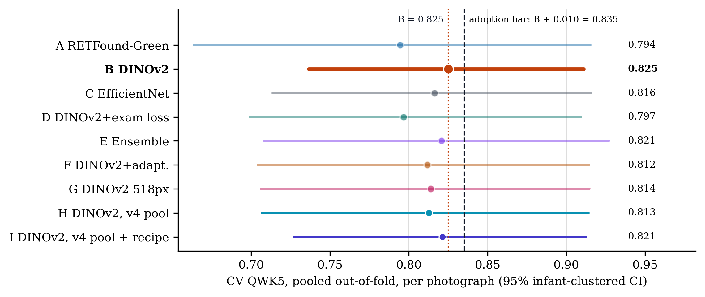{width=100%}

*Figure 3. Selection metric of Amendment 5c: CV pooled out-of-fold photo-level QWK5 with 95% infant-clustered bootstrap CI (2,000 replicates), all nine arms, both seeds pooled. Dotted: arm B (0.825); dashed: the adoption bar B + 0.010 = 0.835. No arm reaches it; the closer v4 arm is I at 0.821.*

# 2 What changed vs v3

## 2.1 Data audit and the v4 pool

Sources:

- protocol: Amendment 5a items 1–5 with the 5a revision, `docs/paper/PROTOCOL_V2.md`
- audit: `results/rop/v4/audit/AUDIT.md`
- pool: `results/prepared/rop_staging/v4/v4_summary.json`

Four changes, all to **training** rows only; validation rows, the infant-to-fold assignment and the 14 exact-duplicate exclusions are unchanged, so v4 CV is scored on the same 6,686 photos as v3 (validation sides of every v3 and v4 CV fold file identical: yes).

1. **Ostrava frame quality (per camera).** An Ostrava frame passes if it is not empty and, against the thresholds of its own device (percentiles over that device's non-empty Ostrava frames), blur_var >= min_blur (10th percentile) and lum_lo <= luminance <= lum_hi (2.5th / 97.5th percentiles); there is no field-of-view criterion.
2. **Cap re-ranking.** Caps unchanged (normal 2, other classes 20 photos per infant and class); within a cap the kept frames are ranked by `blur_rank_in_device descending, ties by image_path`.
3. **Floor.** An (infant, class) cell with fewer than 2 passing frames keeps its 2 best-ranked frames; 1 cell triggered it (`ostrava:39` normal: 8 frames, 1 passing, 1 failing frame kept).
4. **Near-duplicates.** Both members of a cross-fold pair at dHash Hamming distance ≤ 4 **and** pixel MAD ≤ 5 grey levels (256×256 greyscale) leave the training rows: 8 images (Ostrava 0, ROP-VL 0, Shenzhen 8). The superseded hash-only rule would have removed 28. Of 109 pairs at distance ≤ 4, 72 are true duplicates; 14 carry different labels and go to the clinician list (nothing relabelled). All 8 are among the 14 exact duplicates (`exclude_duplicates.csv`) that every kernel already drops at run time, so in practice this rule changes no trained-on photo; the v4 pool differs from v3 through items 1–3.

**Per-camera thresholds** (`thresholds.json`; percentiles over each camera's non-empty Ostrava frames: `min_blur` 10th, `lum_lo` 2.5th, `lum_hi` 97.5th; no field-of-view rule):

| camera | frames | min blur_var | lum_lo | lum_hi | failing | removed | share | blur | dark | bright |
|:------------|-----:|----------:|-----:|------:|------:|------:|----:|---:|---:|-----:|
| Clarity RetCam3 | 1,428 | 23.938 | 77.204 | 162.396 | 205 | 204 | 14.3% | 143 | 36 | 36 |
| Phoenix ICON | 1,946 | 19.390 | 51.714 | 165.087 | 253 | 253 | 13.0% | 195 | 49 | 49 |
| RetCam Envision | 911 | 59.759 | 62.525 | 130.652 | 127 | 127 | 13.9% | 91 | 23 | 23 |

Blur/dark/bright count failures per criterion (a frame can fail more than one). The superseded single-photo-hospital reference (ROP-VL, Shenzhen: min blur_var 40.218, luminance 70.180–164.155, min FOV 0.682) is kept for the record only: superseded by the Amendment 5a revision; record only. It would have failed 2,485 of 4,285 Ostrava frames, including all 125 stage-3 frames.

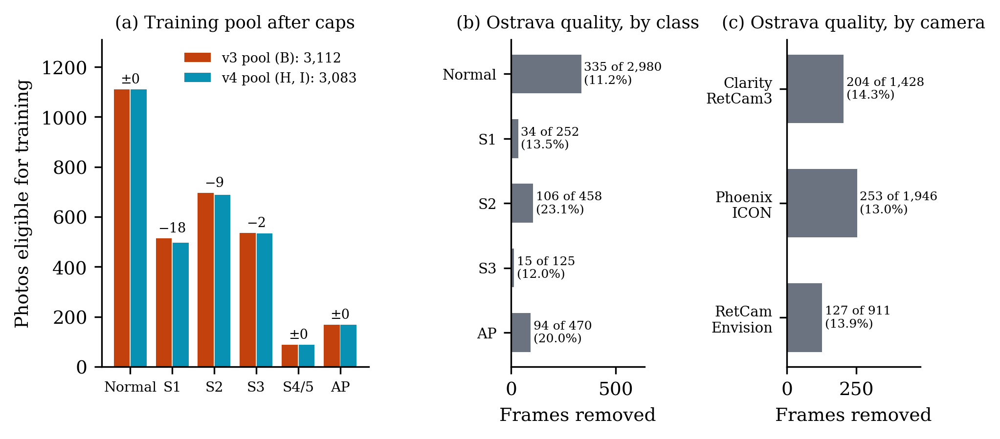{width=100%}

*Figure 1. Data. (a) Photos eligible for training after the per-infant caps: v3 pool 3,112 (arm B) vs v4 pool 3,083 (arms H and I); labels give v4 − v3 (largest change: Stage 1 −18). (b, c) Ostrava frames that failed the per-camera quality rule and left the training candidates: 584 of 4,285 (13.6%), by class and by camera (1 failing frame kept by the 2-frame floor). Validation rows are never filtered.*

## 2.2 Recipe

Values from the three YAMLs (`configs/rop_staging_dinov2.yaml` = B, `configs/rop_staging_dinov2_v4data.yaml` = H, `configs/rop_staging_dinov2_v4recipe.yaml` = I). Where a key is not set, the value the code builds is given in brackets (`models/common/preprocessing.build_transforms`).

| parameter | B | H | I |  |
|:----------------|:-----------------|:-----------------|:--------|:------:|
| image size (px) | 392 | 392 | 392 |  |
| normalize | imagenet | imagenet | imagenet |  |
| lr (peak, top layer) | 0.0001 | 0.0001 | 0.0001 |  |
| layer decay | 0.8 | 0.8 | 0.8 |  |
| weight decay | 0.05 | 0.05 | 0.05 |  |
| epochs | 20 | 20 | 20 |  |
| batch | 16 | 16 | 16 |  |
| label smoothing | 0.05 | 0.05 | 0.1 | differs |
| class-balanced β | 0.999 | 0.999 | 0.999 |  |
| drop path | 0.1 | 0.1 | 0.1 |  |
| dropout | 0.3 | 0.3 | 0.3 |  |
| strong_aug | true | true | true |  |
| site_randomization | true | true | true |  |
| rotation (°) | not set (built: ±15°) | not set (built: ±15°) | 180 | differs |
| min crop scale | not set (built: 0.6) | not set (built: 0.6) | 0.85 | differs |
| gamma range | not set | not set | [0.7, 1.4] | differs |
| gamma p | not set | not set | 0.5 | differs |
| noise σ | not set | not set | 0.02 | differs |
| noise p | not set | not set | 0.3 | differs |
| Fourier block | not set | not set | 3 | differs |
| Fourier p | not set | not set | 0.5 | differs |
| EMA decay | not set | not set | 0.999 | differs |
| head warm-up epochs | not set | not set | 1 | differs |
| fold files | v3 | v4 | v4 | differs |

Fold files: v3 pool `results/prepared/rop_staging/`, v4 pool `results/prepared/rop_staging/v4/` (the YAML names fold 0; the kernel swaps in each fold).

**As-run check.** The as-run configs (`training.config` in `report_data.json`, read from each run's `config.yaml`) equal the YAMLs on every model, preprocess and train key except:

| key | YAML | as run | arms |
|:-----------------------------|:------|:--------------------|:---------|
| `preprocess.cached` | false | true | B, H, I |
| `preprocess.cache_root` | None | `/tmp/_cache768` | B, H, I |

The kernels run the fundus stage once and cache it, identically for all three arms, so the cache does not bear on the comparison.

**Augmentation as built**, in order (B and H build the same list):

| # | B, H | I |
|---:|:------------------------------|:---------------------------------|
| 1 | fundus stage: circle crop, letterbox, CLAHE | fundus stage: circle crop, letterbox, CLAHE |
| 2 | random resized crop to 392 px, scale 0.6–1 | random resized crop to 392 px, scale 0.85–1 |
| 3 | horizontal flip, p 0.5 | horizontal flip, p 0.5 |
| 4 | vertical flip, p 0.5 | vertical flip, p 0.5 |
| 5 | rotation ±15° | rotation ±180° |
| 6 | colour jitter: brightness 0.7–1.3, contrast 0.7–1.3, saturation 0.8–1.2 | colour jitter: brightness 0.7–1.3, contrast 0.7–1.3, saturation 0.8–1.2 |
| 7 | colour jitter: saturation 0.7–1.3, hue ±0.05 | colour jitter: saturation 0.7–1.3, hue ±0.05 |
| 8 | greyscale, p 0.1 | gamma U(0.7, 1.4), p 0.5 |
| 9 | resolution jitter down to 0.33, p 0.5 | greyscale, p 0.1 |
| 10 | affine: translate 0.1, scale 0.88–1.12, shear ±8° | resolution jitter down to 0.33, p 0.5 |
| 11 | perspective 0.2, p 0.3 | affine: translate 0.1, scale 0.88–1.12, shear ±8° |
| 12 | Gaussian blur 3×3, σ 0.1–2 | perspective 0.2, p 0.3 |
| 13 | normalise (imagenet statistics) | Gaussian blur 3×3, σ 0.1–2 |
| 14 | random erasing 0.02–0.15 of the area, p 0.35 | pixel noise σ 0.02, p 0.3 |
| 15 |  | normalise (imagenet statistics) |
| 16 |  | random erasing 0.02–0.15 of the area, p 0.35 |
| 17 |  | batch: Fourier amplitude swap, centred 3×3 block, random batch partner, p 0.5 |

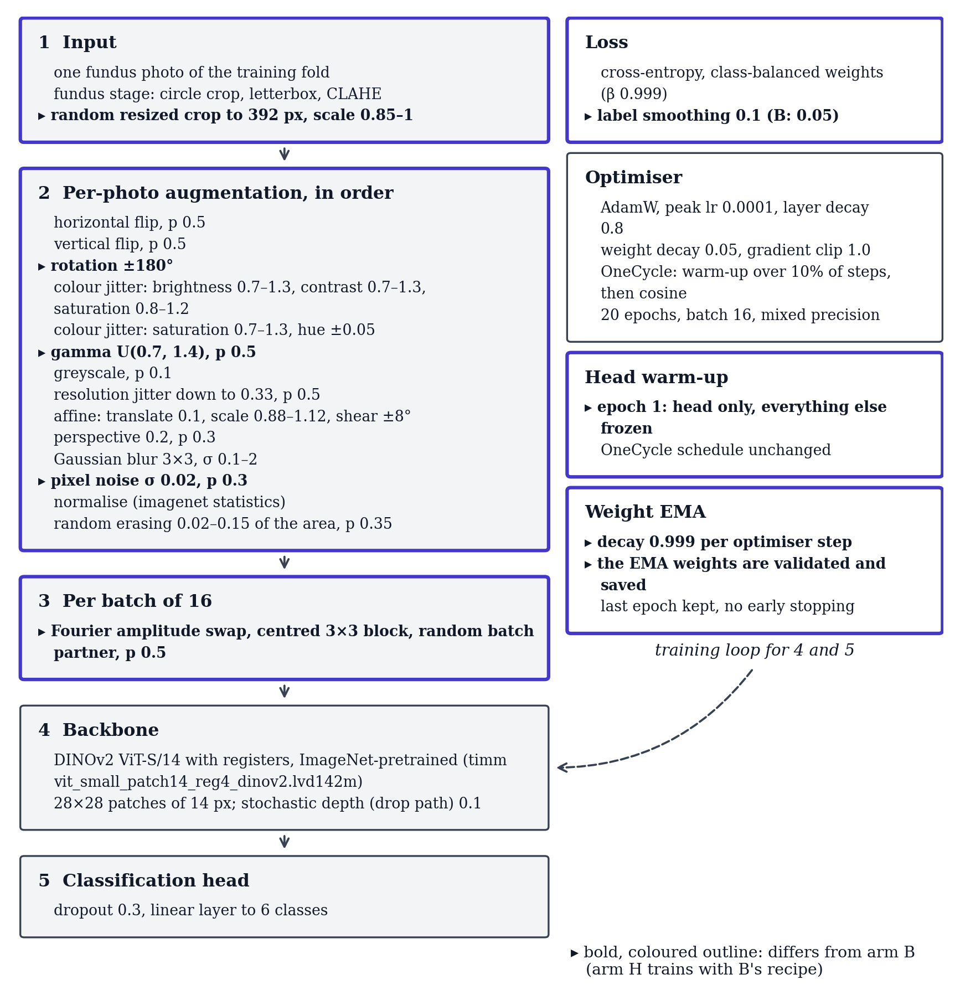{width=100%}

*Figure 2. Arm I's training recipe as built from `configs/rop_staging_dinov2_v4recipe.yaml` by `models/common/preprocessing.build_transforms` and the training loop (`models/common/train_utils.py`, `models/common/optim.py`). Marked items differ from arm B; everything else, including the 392-px input and the 20-epoch OneCycle schedule, equals B. Arm H is B's recipe on the v4 pool.*

# 3 Data

## 3.1 Pool and training rows

The cross-validation pool holds 6,700 photos of 1,528 infants from three sources; validation always scores all of them (minus 14 exact duplicates). Training uses the capped rows: 3,112 in v3, 3,083 in v4 (1,527 infants). Cells: pool photos · v3 training rows → v4 training rows.

| source | Normal | Stage 1 | Stage 2 | Stage 3 | Stage 4/5 | AP-ROP | total |
|:----------|----------:|-------:|-------:|-------:|------:|-------:|----------:|
| Ostrava (148 infants) | 2,980 · 270 → 270 | 252 · 190 → 173 | 458 · 195 → 191 | 125 · 40 → 40 | 0 · 0 → 0 | 470 · 20 → 20 | 4,285 · 715 → 694 |
| ROP-VL (983 infants) | 623 · 623 → 623 | 236 · 236 → 236 | 338 · 338 → 338 | 241 · 241 → 241 | 89 · 89 → 89 | 148 · 148 → 148 | 1,675 · 1,675 → 1,675 |
| Shenzhen (397 infants) | 234 · 216 → 216 | 89 · 89 → 88 | 163 · 163 → 158 | 254 · 254 → 252 | 0 · 0 → 0 | 0 · 0 → 0 | 740 · 722 → 714 |
| **all** | 3,837 · 1,109 → 1,109 | 577 · 515 → 497 | 959 · 696 → 687 | 620 · 535 → 533 | 89 · 89 → 89 | 618 · 168 → 168 | 6,700 · 3,112 → 3,083 |

Rows that changed identity between the pools (same caps, different frames): Ostrava: 439 v3-only, 418 v4-only; ROP-VL: 0 v3-only, 0 v4-only; Shenzhen: 18 v3-only, 10 v4-only. 131 of v3's Ostrava training rows failed the quality rule.

## 3.2 Ostrava frames removed by quality

| class | Ostrava frames | infants | failing | removed | share | blur | dark | bright |
|:---------|--------------:|-------:|-------:|-------:|-----:|----:|----:|------:|
| Normal | 2,980 | 135 | 336 | 335 | 11.2% | 225 | 72 | 69 |
| Stage 1 | 252 | 12 | 34 | 34 | 13.5% | 26 | 0 | 8 |
| Stage 2 | 458 | 11 | 106 | 106 | 23.1% | 94 | 30 | 2 |
| Stage 3 | 125 | 2 | 15 | 15 | 12.0% | 11 | 6 | 0 |
| Stage 4/5 | 0 | 0 | 0 | 0 | n/a | 0 | 0 | 0 |
| AP-ROP | 470 | 1 | 94 | 94 | 20.0% | 73 | 0 | 29 |
| **all** | 4,285 | 148 | 585 | 584 | 13.6% | 429 | 108 | 108 |

Failing / total frames per camera and class (the AP-ROP frames all come from one camera and 1 infant):

| camera | Normal | Stage 1 | Stage 2 | Stage 3 | Stage 4/5 | AP-ROP | all |
|:------------|---------:|------:|-------:|-------:|-------:|-------:|---------:|
| Clarity RetCam3 | 68 / 653 | 19 / 85 | 24 / 220 | – | – | 94 / 470 | 205 / 1,428 |
| Phoenix ICON | 182 / 1,711 | 14 / 83 | 57 / 152 | – | – | – | 253 / 1,946 |
| RetCam Envision | 86 / 616 | 1 / 84 | 25 / 86 | 15 / 125 | – | – | 127 / 911 |

## 3.3 CV folds

| fold | train infants | v3 train | v4 train | B kernel | H kernel | I kernel | val | Normal tr/val | S1 tr/val | S2 tr/val | S3 tr/val | S4/5 tr/val | AP tr/val |
|:---|-------:|----:|----:|----:|----:|----:|---:|-------:|-----:|-----:|-----:|------:|-----:|
| CV 0 | 1,231 | 2,462 | 2,453 | 2,462 | 2,447 | 2,447 | 1,691 | 888 / 767 | 394 / 137 | 554 / 163 | 405 / 129 | 70 / 19 | 142 / 476 |
| CV 1 | 1,228 | 2,477 | 2,469 | 2,477 | 2,465 | 2,465 | 1,252 | 890 / 756 | 395 / 114 | 530 / 220 | 443 / 116 | 73 / 16 | 138 / 30 |
| CV 2 | 1,255 | 2,542 | 2,528 | 2,542 | 2,524 | 2,524 | 1,252 | 888 / 772 | 400 / 123 | 555 / 193 | 482 / 110 | 71 / 18 | 132 / 36 |
| CV 3 | 1,200 | 2,459 | 2,442 | 2,459 | 2,438 | 2,438 | 1,252 | 888 / 766 | 394 / 111 | 562 / 182 | 400 / 134 | 71 / 18 | 127 / 41 |
| CV 4 | 1,194 | 2,452 | 2,440 | 2,452 | 2,434 | 2,434 | 1,253 | 882 / 776 | 405 / 92 | 547 / 201 | 402 / 131 | 71 / 18 | 133 / 35 |

v3/v4 train = rows in the fold files; kernel = rows the kernel reports training on (exact duplicates dropped at run time). Per-class cells: v4 train / validation photos.

## 3.4 Leave-one-source-out folds

| held out | arms | val photos | val infants | Normal train | S1 train | S2 train | S3 train | S4/5 train | AP train | train |
|:-----|-----:|-------:|-------:|--------:|-----:|-----:|-----:|-------:|-----:|---:|
| Shenzhen | B | 728 | 396 | 893 | 426 | 533 | 280 | 89 | 167 | 2,388 |
| Shenzhen | H, I | 728 | 396 | 893 | 409 | 529 | 280 | 89 | 167 | 2,367 |
| Ostrava | B, H, I | 4,285 | 148 | 839 | 322 | 494 | 492 | 89 | 147 | 2,383 |
| ROP-VL | B | 1,673 | 983 | 486 | 276 | 351 | 292 | 0 | 20 | 1,425 |
| ROP-VL | H, I | 1,673 | 983 | 486 | 259 | 347 | 292 | 0 | 20 | 1,404 |

Fold files: Shenzhen `fold_site.csv`, Ostrava `fold_loso_ostrava.csv`, ROP-VL `fold_loso_ropvl.csv`. Validation photos exclude exact duplicates (Shenzhen 12, Ostrava 0, ROP-VL 2). Training columns: rows each class contributes to the LOSO model's training set (`train_support` in `v3_scores.json`). A zero means the held-out source is the only one with that class.

## 3.5 The new hospital (Multi-View)

Dev half: Multi-View (held-out hospital), development half; 116 infants. Eye label = the most severe photo label; eye prediction = the most severe predicted class over the eye's photos.

| unit | Normal | Stage 1 | Stage 2 | Stage 3 | Stage 4/5 | AP-ROP | total |
|:-------|-------:|--------:|--------:|--------:|-----------:|-------:|------:|
| photos | 150 | 190 | 135 | 168 | 14 | 6 | 663 |
| eyes | 50 | 68 | 46 | 59 | 5 | 2 | 230 |

Locked half: 661 photos, 230 eyes, 116 infants (untouched for v3; counts quoted from PROTOCOL_V2, labels not read). Not opened for v4.

## 3.6 Why 5 folds, 2 seeds, 20 epochs

*Verbatim from `docs/v4/README.md`.*

**Why 5 folds.** The pool's 1,528 infants are split into five groups. Each model trains on four groups (about 80% of the data) and is scored on the fifth. After five models, every infant has been scored exactly once, by a model that never saw that infant. The "CV" numbers pool those five scorings.

**Why the folds are grouped by infant.** Ostrava gives 4,285 photos of only 148 infants, about 29 per infant, and the frames of one examination look nearly identical. If one infant's frames were in both training and validation, the model would be marked on near-copies of photos it learned from. So every photo of an infant sits in the same fold.

**Why 2 seeds (42 and 1337).** Near the end of its schedule a single run's macro-F1 still moves by 0.007–0.056, so one run is a noisy measurement. A second seed shows how much of a difference is noise; the headline numbers pool both seeds.

**Why 20 epochs, OneCycle, last-epoch weights.** Every arm uses the same fixed schedule (OneCycle: the learning rate rises over the first 10% of steps, then falls along a cosine) and keeps the weights from the last epoch. There is no early stopping (`eval.early_stopping: false`). A CV validation fold holds only 16–19 stage 4/5 photos, so macro-F1 jumps from epoch to epoch. Picking the best epoch on that same validation fold would report the luckiest epoch, not the model.

**Why batch 16 and 392 px.** Batch 16, 20 epochs and the class-balanced loss are the protocol's parity rules with the EfficientNet baseline (arm C). DINOv2 ViT-S/14 cuts the image into 14-pixel patches, so 392 px gives a 28 × 28 patch grid (384 is not a multiple of 14). On Kaggle's Tesla T4 (16 photos per batch fit in its memory) a 392-px fold takes about half an hour. Arm G tests 518 px, DINOv2's pre-training size; it also kept batch 16, so the protocol's out-of-memory fallback (batch 8 with 2-step gradient accumulation) was never used.

**Why per-infant caps (20 photos per class, 2 for normal).** Without caps, Ostrava's 148 infants (about 10% of the infants) would supply 64% of the training photos. Normal is the commonest class (3,837 of the 6,700 pool photos), so it is capped at 2 per infant. After the caps, 3,112 training photos remain in v3; v4 (the same caps plus the Ostrava quality check and the near-duplicate rule) keeps 3,083. Inside a cap, v4 keeps the frames that pass the quality check, sharpest first.

**Why validation is not capped.** Validation scores all 6,700 pool photos at their natural class mix, so the numbers describe the data as it is, not a balanced sample. Confidence intervals resample whole infants, so one heavily-photographed infant cannot pass as many independent cases.

**Leave-one-source-out (LOSO) folds, and why three.** The pool has three sources: Ostrava, ROP-VL and Shenzhen. A LOSO fold trains on two of them and validates on every photo of the third, which tests how a model copes with a hospital and camera it never saw. There is one fold per source: `fold_site` (Shenzhen, from v3), `fold_loso_ostrava` and `fold_loso_ropvl`. Stage 4/5 exists only in ROP-VL, so the ROP-VL fold scores stage 4/5 with zero training examples.

# 4 Results

## 4.1 Headline, all arms

**CV, pooled out-of-fold, per photograph** (6,686 photos, both seeds):

| arm | QWK5 | QWK5 95% CI | accuracy | balanced acc. | macro-F1 | any-ROP AUC | AP-ROP recall |
|:-----------------|---:|---------:|-----:|--------:|-----:|-------:|--------:|
| A RETFound-Green | 0.794 | [0.664, 0.915] | 0.758 | 0.656 | 0.643 | 0.977 | 0.268 |
| B DINOv2 | 0.825 | [0.737, 0.911] | 0.766 | 0.674 | 0.653 | 0.979 | 0.389 |
| C EfficientNet | 0.816 | [0.713, 0.916] | 0.788 | 0.672 | 0.656 | 0.967 | 0.382 |
| D DINOv2+exam loss | 0.797 | [0.699, 0.909] | 0.802 | 0.670 | 0.661 | 0.942 | 0.490 |
| E Ensemble | 0.821 | [0.708, 0.927] | 0.787 | 0.680 | 0.664 | 0.981 | 0.328 |
| F DINOv2+adapt. † | 0.812 | [0.704, 0.915] | 0.760 | 0.663 | 0.644 | 0.980 | 0.327 |
| G DINOv2 518px | 0.814 | [0.706, 0.915] | 0.764 | 0.667 | 0.647 | 0.984 | 0.301 |
| H DINOv2, v4 pool | 0.813 | [0.707, 0.914] | 0.765 | 0.660 | 0.646 | 0.982 | 0.306 |
| I DINOv2, v4 pool + recipe | 0.821 | [0.727, 0.912] | 0.750 | 0.645 | 0.618 | 0.982 | 0.269 |

**Multi-View dev, per eye** (230 eyes; mean over 10 fold-seed models; descriptive):

| arm | QWK5 | QWK5 95% CI | accuracy | balanced acc. | macro-F1 | any-ROP AUC | any-ROP AP |
|:------------------|---:|---------:|-----:|---------:|-----:|-------:|-------:|
| A RETFound-Green | 0.774 | [0.707, 0.828] | 0.632 | 0.628 | 0.563 | 0.935 | 0.984 |
| B DINOv2 | 0.756 | [0.679, 0.821] | 0.630 | 0.642 | 0.566 | 0.937 | 0.984 |
| C EfficientNet | 0.760 | [0.680, 0.822] | 0.624 | 0.679 | 0.573 | 0.943 | 0.986 |
| D DINOv2+exam loss | 0.746 | [0.671, 0.810] | 0.609 | 0.606 | 0.542 | 0.935 | 0.984 |
| E Ensemble | 0.770 | [0.697, 0.827] | 0.639 | 0.638 | 0.568 | 0.944 | 0.986 |
| F DINOv2+adapt. † | 0.744 | [0.665, 0.812] | 0.624 | 0.617 | 0.551 | 0.940 | 0.985 |
| G DINOv2 518px | 0.767 | [0.697, 0.827] | 0.626 | 0.609 | 0.551 | 0.939 | 0.985 |
| H DINOv2, v4 pool | 0.750 | [0.674, 0.814] | 0.620 | 0.611 | 0.556 | 0.941 | 0.985 |
| I DINOv2, v4 pool + recipe | 0.776 | [0.705, 0.834] | 0.633 | 0.618 | 0.560 | 0.944 | 0.986 |

† F: transductive (dev photos seen unlabelled during training). AP-ROP recall = the binary AP-ROP branch metric of the selection table (mean over seeds).

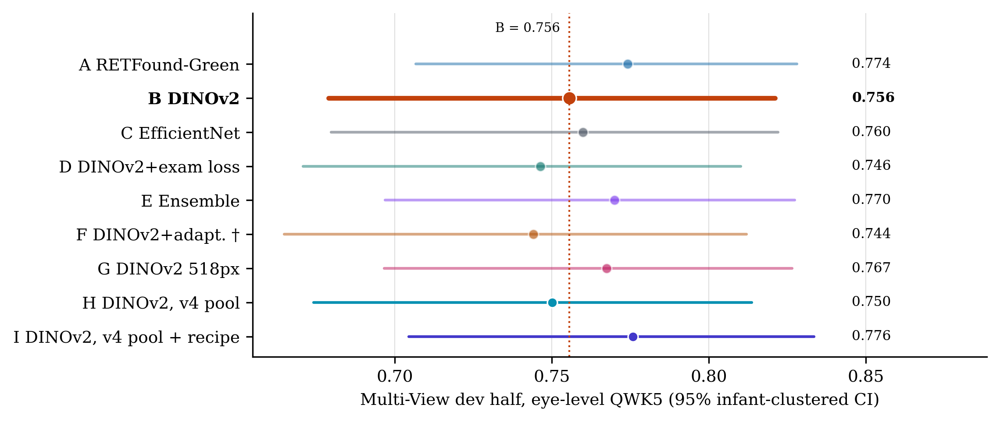{width=100%}

*Figure 4. The new hospital (Multi-View dev half: 230 eyes, 116 infants, 663 photos), eye-level QWK5 with 95% CI, mean over each arm's 10 fold-seed models. Descriptive (development-external), not a selection input. Range 0.744 (F) to 0.776 (I). † F: dev photos were seen unlabelled during training.*

## 4.2 Per stage: B, H, I

**CV, per photograph:**

| stage | arm | precision | recall | specificity | F1 | AUC (one-vs-rest) | support |
|:---------|:---|---------:|------:|-----------:|-----:|----------------:|-------:|
| Normal | B | 0.959 | 0.909 | 0.948 | 0.933 | 0.979 | 3,837 |
|  | H | 0.952 | 0.924 | 0.938 | 0.938 | 0.982 | 3,837 |
|  | I | 0.960 | 0.909 | 0.949 | 0.934 | 0.982 | 3,837 |
| Stage 1 | B | 0.302 | 0.583 | 0.873 | 0.398 | 0.821 | 574 |
|  | H | 0.326 | 0.570 | 0.889 | 0.414 | 0.825 | 574 |
|  | I | 0.298 | 0.489 | 0.892 | 0.370 | 0.816 | 574 |
| Stage 2 | B | 0.583 | 0.561 | 0.933 | 0.572 | 0.901 | 952 |
|  | H | 0.520 | 0.557 | 0.914 | 0.538 | 0.894 | 952 |
|  | I | 0.497 | 0.568 | 0.905 | 0.530 | 0.880 | 952 |
| Stage 3 | B | 0.788 | 0.722 | 0.980 | 0.753 | 0.936 | 617 |
|  | H | 0.807 | 0.725 | 0.982 | 0.763 | 0.922 | 617 |
|  | I | 0.725 | 0.741 | 0.971 | 0.733 | 0.951 | 617 |
| Stage 4/5 | B | 0.668 | 0.882 | 0.994 | 0.759 | 0.965 | 89 |
|  | H | 0.740 | 0.876 | 0.996 | 0.802 | 0.964 | 89 |
|  | I | 0.677 | 0.893 | 0.994 | 0.770 | 0.980 | 89 |
| AP-ROP | B | 0.705 | 0.389 | 0.984 | 0.501 | 0.835 | 617 |
|  | H | 0.682 | 0.306 | 0.985 | 0.422 | 0.760 | 617 |
|  | I | 0.617 | 0.269 | 0.982 | 0.372 | 0.813 | 617 |

**Multi-View dev, per eye:**

| stage | arm | precision | recall | specificity | F1 | AUC (one-vs-rest) | support |
|:---------|:---|---------:|------:|-----------:|-----:|----------------:|-------:|
| Normal | B | 0.623 | 0.948 | 0.841 | 0.752 | 0.946 | 50 |
|  | H | 0.625 | 0.950 | 0.841 | 0.754 | 0.946 | 50 |
|  | I | 0.649 | 0.936 | 0.859 | 0.766 | 0.935 | 50 |
| Stage 1 | B | 0.607 | 0.510 | 0.860 | 0.554 | 0.721 | 68 |
|  | H | 0.600 | 0.497 | 0.859 | 0.542 | 0.714 | 68 |
|  | I | 0.648 | 0.506 | 0.885 | 0.567 | 0.738 | 68 |
| Stage 2 | B | 0.666 | 0.546 | 0.931 | 0.599 | 0.835 | 46 |
|  | H | 0.622 | 0.539 | 0.918 | 0.576 | 0.842 | 46 |
|  | I | 0.628 | 0.596 | 0.909 | 0.609 | 0.844 | 46 |
| Stage 3 | B | 0.867 | 0.566 | 0.970 | 0.684 | 0.879 | 59 |
|  | H | 0.864 | 0.551 | 0.970 | 0.672 | 0.878 | 59 |
|  | I | 0.821 | 0.559 | 0.958 | 0.665 | 0.878 | 59 |
| Stage 4/5 | B | 0.760 | 0.580 | 0.996 | 0.650 | 0.683 | 5 |
|  | H | 0.802 | 0.580 | 0.996 | 0.668 | 0.711 | 5 |
|  | I | 0.783 | 0.560 | 0.996 | 0.637 | 0.844 | 5 |
| AP-ROP | B | 0.088 | 0.700 | 0.935 | 0.155 | 0.969 | 2 |
|  | H | 0.071 | 0.550 | 0.934 | 0.125 | 0.958 | 2 |
|  | I | 0.067 | 0.550 | 0.931 | 0.119 | 0.944 | 2 |

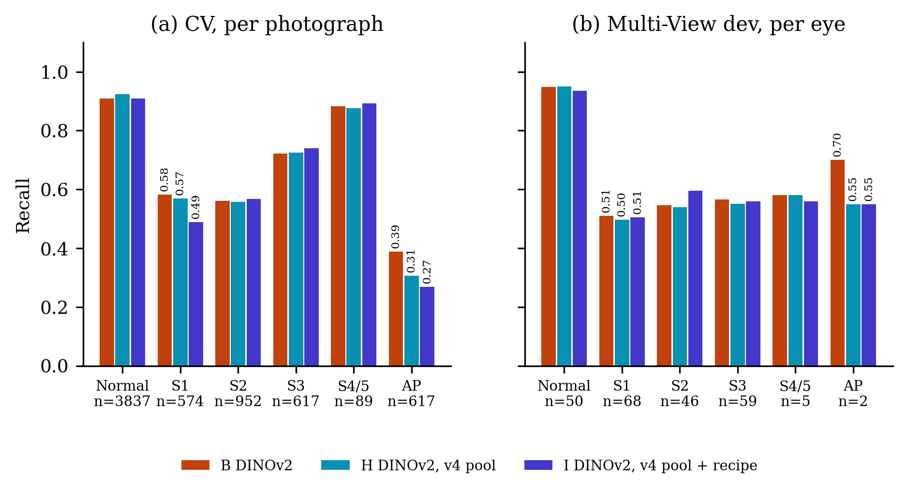{width=100%}

*Figure 6. Recall per stage for B, H and I (mean over the arm's lists: 2 pooled CV lists, 10 dev lists). n = photos (CV) or eyes (dev). Stage 1 and AP-ROP are labelled.*

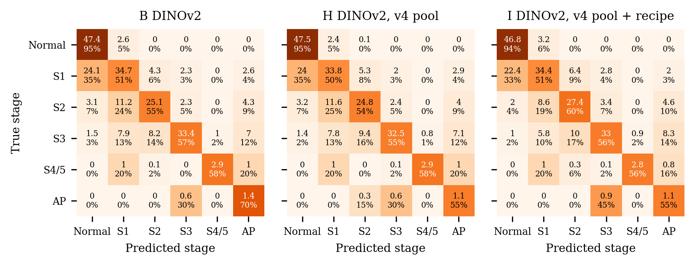{width=100%}

*Figure 7. Eye-level confusion matrices on the Multi-View dev half (230 eyes): counts are means over each arm's 10 fold-seed models (hence decimals); the percentage is the row share (recall on the diagonal).*

## 4.3 Per fold

Per seed × CV fold, duplicates excluded (`report_data.json` → `per_fold`):

| seed | fold | QWK5 B | QWK5 H | QWK5 I | mF1 B | mF1 H | mF1 I | acc B | acc H | acc I |
|:-----|:-----|-------:|-------:|-------:|------:|------:|------:|------:|------:|------:|
| 42 | 0 | 0.743 | 0.662 | 0.677 | 0.596 | 0.556 | 0.523 | 0.698 | 0.641 | 0.625 |
| 42 | 1 | 0.870 | 0.880 | 0.885 | 0.738 | 0.751 | 0.735 | 0.805 | 0.820 | 0.817 |
| 42 | 2 | 0.853 | 0.832 | 0.873 | 0.596 | 0.585 | 0.608 | 0.720 | 0.745 | 0.753 |
| 42 | 3 | 0.904 | 0.915 | 0.912 | 0.767 | 0.769 | 0.751 | 0.792 | 0.817 | 0.790 |
| 42 | 4 | 0.898 | 0.914 | 0.910 | 0.724 | 0.769 | 0.706 | 0.836 | 0.837 | 0.815 |
| 1337 | 0 | 0.666 | 0.672 | 0.704 | 0.559 | 0.564 | 0.531 | 0.657 | 0.649 | 0.641 |
| 1337 | 1 | 0.879 | 0.883 | 0.876 | 0.742 | 0.733 | 0.727 | 0.826 | 0.821 | 0.813 |
| 1337 | 2 | 0.857 | 0.842 | 0.824 | 0.560 | 0.583 | 0.570 | 0.720 | 0.754 | 0.730 |
| 1337 | 3 | 0.923 | 0.913 | 0.915 | 0.772 | 0.763 | 0.749 | 0.816 | 0.815 | 0.800 |
| 1337 | 4 | 0.908 | 0.912 | 0.888 | 0.746 | 0.747 | 0.678 | 0.852 | 0.840 | 0.793 |
| mean |  | 0.850 | 0.842 | 0.846 | 0.680 | 0.682 | 0.658 | 0.772 | 0.774 | 0.758 |
| SD |  | 0.082 | 0.097 | 0.086 | 0.090 | 0.096 | 0.091 | 0.067 | 0.075 | 0.072 |

**AP-ROP by fold.** Kernel-side AP-ROP recall (`metrics.json`, 6-class, before duplicate exclusion), seed 42 / 1337, with the source of the AP-ROP validation photos (v4 fold files):

| fold | AP-ROP val photos by source | B | H | I |
|:---------|:---------------------------|---------:|---------:|---------:|
| CV 0 | Ostrava 470 (1 inf.), ROP-VL 6 (5 inf.) | 0.326 / 0.166 | 0.116 / 0.168 | 0.065 / 0.137 |
| CV 1 | ROP-VL 30 (21 inf.) | 0.800 / 0.867 | 0.800 / 0.800 | 0.800 / 0.800 |
| CV 2 | ROP-VL 36 (24 inf.) | 0.944 / 0.889 | 0.833 / 0.806 | 0.917 / 0.861 |
| CV 3 | ROP-VL 41 (28 inf.) | 0.829 / 0.854 | 0.927 / 0.854 | 0.829 / 0.805 |
| CV 4 | ROP-VL 35 (25 inf.) | 0.857 / 0.886 | 0.914 / 0.914 | 0.829 / 0.829 |
| CV 0 pooled |  | 0.246 | 0.142 | 0.101 |
| CV 1–4 pooled |  | 0.866 | 0.859 | 0.835 |

Fold 0 holds 470 AP-ROP photos of 1 Ostrava infant, scored by models trained on 0 Ostrava and 142 ROP-VL AP-ROP photos; there B reaches 0.246, H 0.142 and I 0.101, and the two seeds of one arm differ by up to 0.160 (B). On folds 1–4 (ROP-VL AP-ROP only) the arms sit at 0.866, 0.859 and 0.835.

## 4.4 Leave-one-source-out

| arm | pool | held out | photos | infants | QWK5 | 95% CI | macro-F1 | 95% CI | accuracy | S4/5 train |
|:---|:---|:------|----:|-----:|------:|----------:|------:|----------:|------:|-------:|
| B | v3 | Shenzhen | 728 | 396 | 0.962 | [0.953, 0.971] | 0.841 | [0.808, 0.871] | 0.882 | 89 |
| B | v3 | Ostrava | 4,285 | 148 | 0.740 | [0.398, 0.845] | 0.483 | [0.384, 0.596] | 0.791 | 89 |
| B | v3 | ROP-VL | 1,673 | 983 | 0.799 | [0.771, 0.827] | 0.452 | [0.437, 0.467] | 0.677 | 0 |
| B |  | **mean** |  |  | **0.834** |  |  |  |  |  |
| H | v4 | Shenzhen | 728 | 396 | 0.960 | [0.950, 0.969] | 0.839 | [0.808, 0.870] | 0.877 | 89 |
| H | v4 | Ostrava | 4,285 | 148 | 0.766 | [0.452, 0.858] | 0.479 | [0.380, 0.590] | 0.796 | 89 |
| H | v4 | ROP-VL | 1,673 | 983 | 0.801 | [0.774, 0.824] | 0.443 | [0.427, 0.458] | 0.658 | 0 |
| H |  | **mean** |  |  | **0.842** |  |  |  |  |  |
| I | v4 | Shenzhen | 728 | 396 | 0.942 | [0.926, 0.956] | 0.777 | [0.741, 0.814] | 0.840 | 89 |
| I | v4 | Ostrava | 4,285 | 148 | 0.779 | [0.471, 0.875] | 0.487 | [0.394, 0.595] | 0.804 | 89 |
| I | v4 | ROP-VL | 1,673 | 983 | 0.796 | [0.768, 0.820] | 0.462 | [0.445, 0.479] | 0.676 | 0 |
| I |  | **mean** |  |  | **0.839** |  |  |  |  |  |

Recall per class on the held-out source (mean over seeds; – = class absent there):

| held out | arm | Normal | Stage 1 | Stage 2 | Stage 3 | Stage 4/5 | AP-ROP |
|:----------|:----|-------:|--------:|--------:|--------:|-----------:|-------:|
| Shenzhen | B | 0.996 | 0.576 | 0.808 | 0.927 | – | – |
|  | H | 0.998 | 0.593 | 0.788 | 0.917 | – | – |
|  | I | 0.996 | 0.390 | 0.724 | 0.921 | – | – |
| Ostrava | B | 0.953 | 0.143 | 0.204 | 0.364 | – | 0.794 |
|  | H | 0.967 | 0.133 | 0.201 | 0.348 | – | 0.770 |
|  | I | 0.969 | 0.153 | 0.194 | 0.364 | – | 0.821 |
| ROP-VL | B | 0.936 | 0.735 | 0.602 | 0.715 | 0.000 | 0.003 |
|  | H | 0.888 | 0.710 | 0.602 | 0.735 | 0.000 | 0.003 |
|  | I | 0.943 | 0.481 | 0.667 | 0.810 | 0.000 | 0.065 |

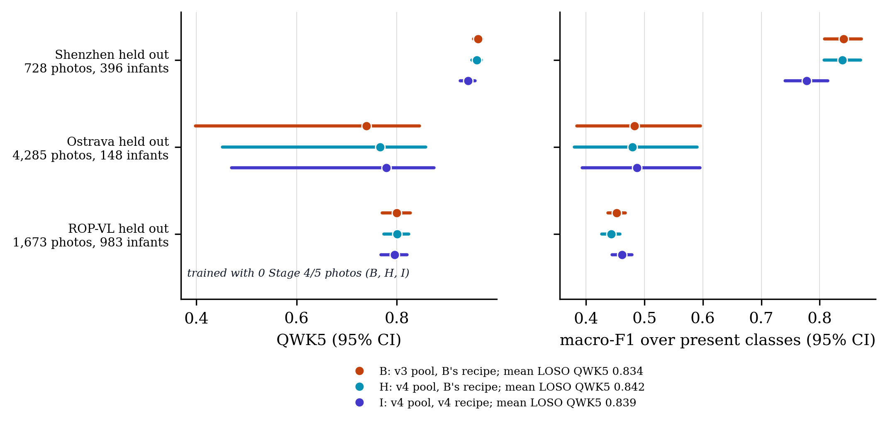{width=100%}

*Figure 8. Leave-one-source-out: each model trains on two sources and is scored on every photo of the third (both seeds pooled; 95% infant-clustered CI). B trains on the v3 pool, H and I on the v4 pool. ROP-VL is the only source with stage 4/5, so its fold scores that stage with zero training examples.*

## 4.5 Paired contrasts

| pair | level | QWK5 a | QWK5 b | Δ QWK5 | 95% CI | Δ macro-F1 | 95% CI | infants |
|:----|:------|-----:|-----:|-----:|------------:|--------:|-------------:|------:|
| H − B | CV photo | 0.813 | 0.825 | −0.013 | [−0.031, 0.009] | −0.006 | [−0.017, 0.019] | 1,527 |
|  | dev eye | 0.750 | 0.756 | −0.005 | [−0.015, 0.003] | −0.009 | [−0.023, 0.009] | 116 |
| I − B | CV photo | 0.821 | 0.825 | −0.004 | [−0.015, 0.007] | −0.035 | [−0.053, −0.001] | 1,527 |
|  | dev eye | 0.776 | 0.756 | +0.020 | [0.003, 0.041] | −0.005 | [−0.057, 0.033] | 116 |
| I − H | CV photo | 0.821 | 0.813 | +0.009 | [−0.007, 0.020] | −0.028 | [−0.043, −0.010] | 1,527 |
|  | dev eye | 0.776 | 0.750 | +0.026 | [0.006, 0.046] | +0.004 | [−0.050, 0.045] | 116 |
| A − B | CV photo | 0.794 | 0.825 | −0.031 | [−0.077, 0.015] | −0.010 | [−0.022, 0.035] | 1,527 |
|  | dev eye | 0.774 | 0.756 | +0.018 | [0.000, 0.041] | −0.003 | [−0.032, 0.016] | 116 |
| A − C | CV photo | 0.794 | 0.816 | −0.022 | [−0.052, 0.008] | −0.013 | [−0.025, 0.012] | 1,527 |
|  | dev eye | 0.774 | 0.760 | +0.014 | [−0.012, 0.048] | −0.009 | [−0.063, 0.031] | 116 |

CV: CV pooled out-of-fold, image level, 14 duplicates excluded; selection-rule context, not a pre-registered endpoint (no 'significant' language). Dev: descriptive, not an endpoint (dev is development-external). A − B and A − C are the v3 secondary/primary pairs, shown for scale.

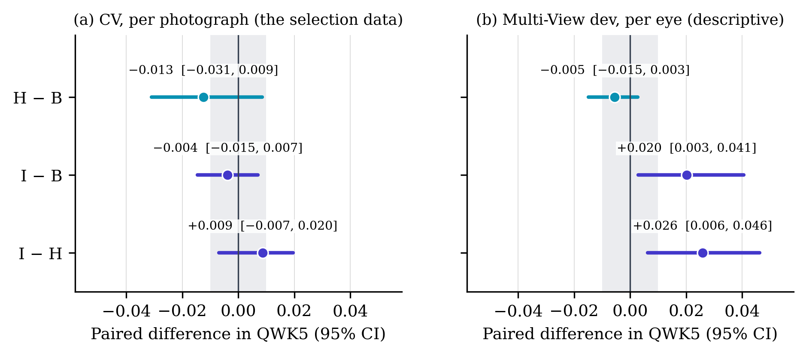{width=100%}

*Figure 5. Paired contrasts of the v4 arms (infant-clustered bootstrap, 2,000 replicates, the same resample for both arms). Grey band: ±0.010, the Amendment 5c margin; line: zero. CV: 6,686 photos (duplicates excluded); dev: 230 eyes.*

## 4.6 Operating point and calibration

Threshold rule: largest threshold on max-over-photos(1-p_normal) with CV-OOF unit-level any-ROP sensitivity >= 0.90 (units pooled over sources). CV units: 1,503 any-ROP, 1,124 normal. Dev at that threshold, mean over the seed's fold models: 180 any-ROP and 50 normal eyes; severe = stage 3 or worse, 66 eyes vs 164 others.

| arm | seed | threshold | CV sens. | CV spec. | dev any-ROP sens. | dev any-ROP spec. | dev severe sens. | dev severe spec. |
|:---|:---|------:|-----:|-----:|-----------:|-----------:|----------:|----------:|
| B | 42 | 0.989 | 0.900 | 0.996 | 0.656 | 1.000 | 0.927 | 0.654 |
| B | 1337 | 0.989 | 0.900 | 0.998 | 0.676 | 1.000 | 0.942 | 0.638 |
| H | 42 | 0.988 | 0.900 | 0.996 | 0.658 | 1.000 | 0.918 | 0.648 |
| H | 1337 | 0.990 | 0.900 | 0.998 | 0.661 | 1.000 | 0.927 | 0.648 |
| I | 42 | 0.981 | 0.900 | 0.998 | 0.676 | 1.000 | 0.912 | 0.626 |
| I | 1337 | 0.982 | 0.900 | 0.998 | 0.680 | 1.000 | 0.918 | 0.623 |

Temperature: CV-OOF unit-level driving-photo probability vectors. Dev-eye ECE pools both seeds (10 bins).

| arm | seed | T | CV ECE before | CV ECE after | CV NLL before | CV NLL after | dev-eye ECE as trained | dev-eye ECE after T |
|:---|:---|---:|--------:|-------:|--------:|-------:|--------------:|------------:|
| B | 42 | 0.850 | 0.053 | 0.047 | 0.521 | 0.509 | 0.157 | 0.203 |
| B | 1337 | 0.851 | 0.054 | 0.057 | 0.515 | 0.503 |  |  |
| H | 42 | 0.836 | 0.049 | 0.036 | 0.507 | 0.493 | 0.167 | 0.215 |
| H | 1337 | 0.851 | 0.049 | 0.043 | 0.515 | 0.504 |  |  |
| I | 42 | 0.620 | 0.136 | 0.034 | 0.596 | 0.504 | 0.061 | 0.196 |
| I | 1337 | 0.631 | 0.136 | 0.047 | 0.608 | 0.522 |  |  |

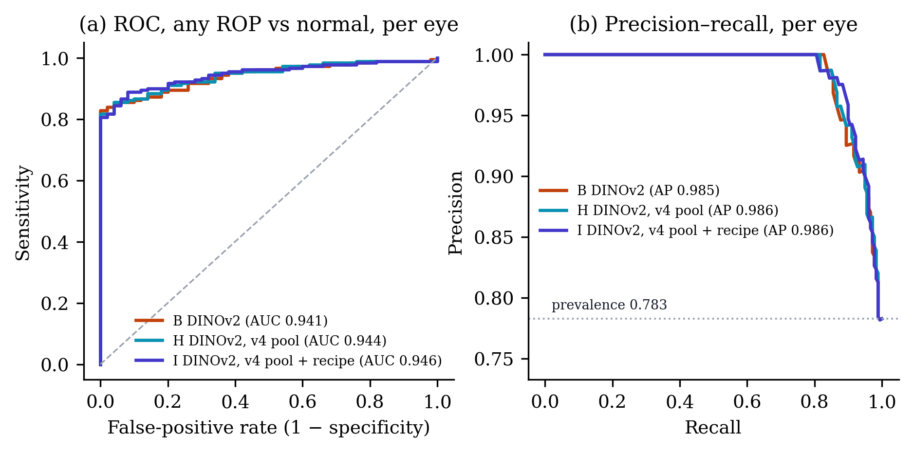{width=100%}

*Figure 10. Any-ROP vs normal on the Multi-View dev eyes for B, H and I. Curves and legend values use the eye score averaged over each arm's 10 fold-seed models; the tables report the mean of the per-model AUC and AP, which is slightly lower.*

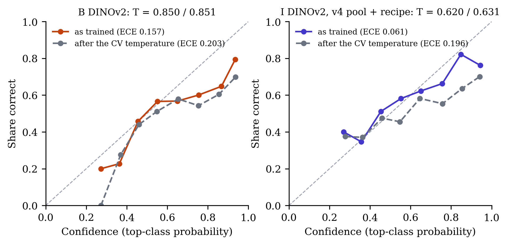{width=100%}

*Figure 11. Reliability of the eye-level stage probabilities on the Multi-View dev half, 10 equal-width bins, both seeds pooled. Grey dashed: after each seed's temperature T (seed 42 / 1337), fitted on CV out-of-fold predictions. T < 1 sharpens the probabilities.*

# 5 Training behaviour

Per-epoch histories from `results/rop/v3/runs/<run dir>/<fold>/metrics.json`; full per-epoch tables in [the run log](V4_RUN_LOG.md). All arms keep the last-epoch weights (`eval.early_stopping: false`), so the best-epoch figures below describe the curves, not the models.

Final-epoch training loss and the epoch of the best held-out macro-F1 (seed 42 / 1337):

| fold | loss B | loss H | loss I | best epoch B | best epoch H | best epoch I |
|:-------------|---------:|---------:|---------:|--------:|--------:|--------:|
| CV 0 | 0.756 / 0.780 | 0.768 / 0.779 | 1.054 / 1.041 | 15 / 6 | 6 / 9 | 8 / 8 |
| CV 1 | 0.748 / 0.740 | 0.745 / 0.761 | 1.036 / 1.039 | 16 / 20 | 15 / 10 | 20 / 20 |
| CV 2 | 0.773 / 0.763 | 0.783 / 0.785 | 1.061 / 1.063 | 16 / 9 | 17 / 13 | 20 / 20 |
| CV 3 | 0.763 / 0.763 | 0.776 / 0.743 | 1.086 / 1.072 | 14 / 9 | 10 / 9 | 12 / 18 |
| CV 4 | 0.748 / 0.773 | 0.787 / 0.772 | 1.053 / 1.068 | 17 / 20 | 18 / 15 | 20 / 20 |
| LOSO Shenzhen (site) | 0.761 / 0.768 | 0.768 / 0.770 | 1.043 / 1.033 | 13 / 14 | 5 / 3 | 20 / 20 |
| LOSO Ostrava | 0.713 / 0.696 | 0.714 / 0.699 | 0.943 / 0.963 | 9 / 16 | 7 / 18 | 11 / 16 |
| LOSO ROP-VL | 0.811 / 0.808 | 0.811 / 0.809 | 1.139 / 1.156 | 16 / 20 | 10 / 15 | 20 / 15 |

CV folds, both seeds (10 runs per arm):

| arm | final loss | smoothing floor | epoch-1 loss | final val mF1 | best val mF1 | best − final | best in last 3 of 20 |
|:---|-------:|----------:|--------:|---------:|--------:|--------:|-------------:|
| B | 0.761 | 0.240 | 1.895 | 0.680 | 0.708 | 0.028 | 2 of 10 |
| H | 0.770 | 0.240 | 1.900 | 0.682 | 0.703 | 0.021 | 1 of 10 |
| I | 1.057 | 0.421 | 2.043 | 0.658 | 0.687 | 0.029 | 7 of 10 |

I's held-out macro-F1 peaks in the last three epochs in 7 of 10 CV runs (B 2, H 1), and its epoch-1 value is 0.121 against B's 0.296: validation runs on the EMA weights, which lag the student and still carry most of the initial weights early on (table below), so I's curve rises later and is still climbing when training stops. B and H usually peak earlier; all three arms keep the last epoch, whatever the peak.

The smoothing floor is the cross-entropy of a prediction equal to the smoothed target with unweighted classes (ε = label smoothing, K = 6); I's floor is higher because ε is higher, so I's loss is not comparable with B's or H's. Validation macro-F1 is comparable.

**EMA residual (arm I).** Protocol, Amendment 5 pre-run note: *4. *EMA start.* The weight EMA of arm I (decay 0.999, no warm-up, no bias correction) leaves a fraction ≈ 0.999^steps of the initial weights in the final average: ≈ 5% on a CV fold (~153 optimizer steps × 20 epochs) and ≈ 17% on `fold_loso_ropvl` (~88 × 20). Disclosed, not changed.* Computed below from the kernel-reported training rows, batch 16, 20 epochs, decay 0.999 (one EMA update per optimiser step; the loader keeps the last partial batch):

| fold | train photos | steps/epoch | steps | initial weights left after epoch 1 | after the last epoch |
|:-------------|--------:|-------:|---:|---------------------:|-------------:|
| CV 0 | 2,447 | 153 | 3,060 | 85.8% | 4.7% |
| CV 1 | 2,465 | 155 | 3,100 | 85.6% | 4.5% |
| CV 2 | 2,524 | 158 | 3,160 | 85.4% | 4.2% |
| CV 3 | 2,438 | 153 | 3,060 | 85.8% | 4.7% |
| CV 4 | 2,434 | 153 | 3,060 | 85.8% | 4.7% |
| LOSO Shenzhen (site) | 2,367 | 148 | 2,960 | 86.2% | 5.2% |
| LOSO Ostrava | 2,383 | 149 | 2,980 | 86.2% | 5.1% |
| LOSO ROP-VL | 1,404 | 88 | 1,760 | 91.6% | 17.2% |

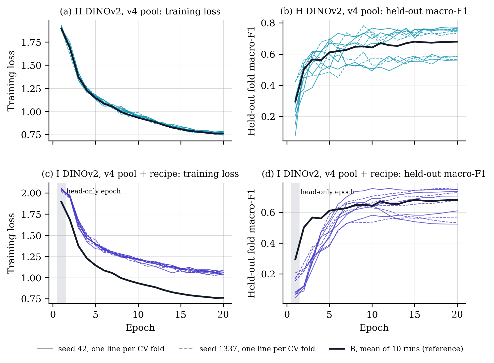{width=100%}

*Figure 9. Training curves of H and I on the five CV folds, both seeds (thin lines), with arm B's mean curve. I trains with label smoothing 0.1 against B's and H's 0.05, so its loss sits higher by construction; its held-out macro-F1 is measured on the EMA weights, whose early epochs still carry most of the initial weights.*

# 6 Cost

| arm | fold-seed runs timed | GPU-hours (timed) | GPU-hours, CV + site (6 folds × 2) | minutes per CV fold | img/s | GPU |
|:---|------------:|----------:|---------------------:|-----------:|---:|-----:|
| B | 12 | 6.5 | 6.5 | 33.3 | 31.8 | Tesla T4 |
| H | 16 | 9.1 | 6.6 | 34.1 | 31.6 | Tesla T4 |
| I | 16 | 9.3 | 6.8 | 34.8 | 32.3 | Tesla T4 |

Minutes per fold (seed 42 / 1337); n/a = not in `training.timing`:

| fold | B | H | I |
|:------------------------|-------------:|-------------:|-------------:|
| CV 0 | 36.7 / 34.3 | 37.2 / 35.2 | 39.6 / 34.1 |
| CV 1 | 32.7 / 32.3 | 34.3 / 32.5 | 36.8 / 31.7 |
| CV 2 | 33.6 / 32.7 | 34.9 / 33.3 | 37.3 / 32.4 |
| CV 3 | 33.3 / 31.8 | 34.0 / 32.5 | 36.3 / 31.7 |
| CV 4 | 33.7 / 31.7 | 34.2 / 32.6 | 36.6 / 31.6 |
| LOSO Shenzhen (site) | 30.0 / 28.6 | 27.7 / 29.4 | 29.4 / 29.6 |
| LOSO Ostrava | n/a / n/a | 47.1 / 51.6 | 48.6 / 52.9 |
| LOSO ROP-VL | n/a / n/a | 24.3 / 26.6 | 25.0 / 26.8 |

Budget set in advance (Amendment 5d, verbatim): *d. **Budget.** B LOSO: 2 folds × 2 seeds ≈ 1.5 GPU-h. H and I: 8 folds × 2 seeds × 2 arms ≈ 17 GPU-h. Smoke ≈ 1 h. Total ≈ 20 h of the 30-h weekly Kaggle allowance. Kernels: `rop-v4-<arm>-s<seed>-a` (folds 0–4) and `-b` (site + LOSO).* Timed H + I: 18.5 GPU-hours. I's per-fold time is 1.022× H's on the CV folds.

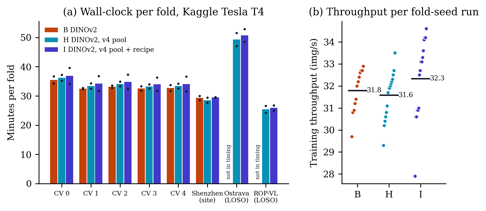{width=100%}

*Figure 12. Cost from the Kaggle kernel logs (report_data training.timing): minutes from one fold's start to the next (bar: mean of the two seeds; dots: seeds) and the throughput logged after 50 steps. B's two LOSO folds ran in a separate kernel whose timing is not in training.timing (see the run log).*

# 7 Interpretation and limitations

- **Nine arms, one plateau.** CV QWK5 runs from 0.794 (A) to 0.825 (B), a span of 0.031, while a single arm's 95% CI is 0.175–0.252 wide. Dev-eye QWK5 runs from 0.744 (F) to 0.776 (I), a span of 0.032. Backbone, resolution, adaptation, exam-level loss, data cleaning and the v4 recipe all land inside a few hundredths of each other.
- **Paired intervals are what can separate arms.** Because both arms are resampled on the same infants, the I − B CV interval is 0.022 wide against marginal CIs of about 0.175. Even so, no v4 interval reaches the +0.010 bar.
- **I's dev gain excludes zero but is descriptive.** I − B on dev eyes is +0.020 [0.003, 0.041] and I − H +0.026 [0.006, 0.046]. The dev half (230 eyes, 116 infants) has been read for all nine arms, so it is one of many looks, and the protocol fixed CV as the selection data before any v4 run. The protocol's minimum detectable difference for the locked half, verbatim: *Minimum detectable difference at 80 % power: ≈ 0.08 eye QWK on 230 eyes / 116 infants (661 images) of the locked half, from the paired infant-clustered bootstrap on saved dev predictions (`review_methodologist.md`, Cons 1). Expected gains at or below this are not confirmable.*
- **AP-ROP is one infant deep in CV.** AP-ROP recall drops from 0.389 (B) to 0.306 (H) and 0.269 (I), and the drop is in fold 0 (0.246 → 0.142 → 0.101), whose 470 Ostrava AP-ROP photos belong to 1 infant. The fold-0 models train on 0 Ostrava AP-ROP photos in every arm, and the pools hold the same number of AP-ROP training rows (168 → 168), so the fall is not lost AP-ROP training data: it is how the rest of the v4 pool (sharper Ostrava frames of other infants and classes) shifts the models' reading of one infant's near-identical frames, and the seed-to-seed spread on that fold is of the same size. On the ROP-VL AP-ROP folds the arms are within 0.032 of each other. Dev has only 2 AP-ROP eyes.
- **Stage 1.** Dev-eye stage-1 recall is unchanged across B, H and I (0.510, 0.497, 0.506). On CV, H matches B (0.570 vs 0.583) and I is lower (0.489); the v4 pool has 18 fewer stage-1 training rows (Ostrava 17, Shenzhen 1); H shares that pool and matches B, so I's lower CV stage-1 recall goes with the recipe, not the pool.
- **Calibration.** I is better calibrated as trained (dev-eye ECE 0.061 vs B 0.157); its CV temperature is further below 1 than B's (0.620 / 0.631 vs 0.850 / 0.851), i.e. I is more under-confident on CV, consistent with EMA plus heavier label smoothing. The CV-fitted temperature makes each of B, H and I worse on dev (ECE after T: B 0.203, H 0.215, I 0.196), so it does not transfer to the new hospital.
- **What would move the numbers.** Not another recipe: nine arms agree within the CI. The bottlenecks are in the data: AP-ROP rests on 1 Ostrava infant plus ROP-VL; stage 4/5 exists only in ROP-VL (89 training photos, 64 infants), so the ROP-VL LOSO fold scores it with zero training rows; Ostrava LOSO CIs span [0.398, 0.845] for B because 148 infants supply 4,285 photos. More infants with stage 4/5 and AP-ROP (data, not recipe) and clinician review of the 14 different-label near-duplicate pairs are the levers. I's dev gain (+0.020) lies below the protocol's minimum detectable difference (0.08 eye QWK), so the locked half (opened once, for arms A–I together, after supervisor approval) cannot confirm a gain of that size either.
- **Scope.** Dev and LOSO are descriptive; F used dev photos without labels during training; B's LOSO folds ran in a separate kernel after the v3 round, on the v3 pool.

# 8 Reproducibility

Regenerate this report (figures and Markdown are deterministic), then the PDF and DOCX:

```
.venv/bin/python scripts/rop_v4_model_report.py
.venv/bin/python scripts/rop_v4_model_report.py --render
```

`--render` runs pandoc from `docs/v4/`, so the figure paths resolve; font size, paper size and link colours come from the front matter:

```
cd docs/v4
pandoc V4_MODEL_REPORT.md -o V4_MODEL_REPORT.pdf --pdf-engine=tectonic \
    -V geometry:margin=2cm -V mainfont="Times New Roman"
pandoc V4_MODEL_REPORT.md -o V4_MODEL_REPORT.docx
```

Last commit touching each input (`git log -1 -- <file>`):

| file | commit | date |
|:----------------------------------------------|:--------|:---------|
| `results/rop/v3/report_data.json` | `b827cce` | 2026-11-01 |
| `results/rop/v3/v3_scores.json` | `b827cce` | 2026-11-01 |
| `results/prepared/rop_staging/v4/v4_summary.json` | `1efccd0` | 2026-10-31 |
| `results/prepared/rop_staging/splits_summary.json` | `f71e9f4` | 2026-08-07 |
| `results/rop/v4/audit/audit_summary.json` | `d0562a9` | 2026-10-31 |
| `results/rop/v4/audit/thresholds.json` | `d0562a9` | 2026-10-31 |
| `configs/rop_staging_dinov2.yaml` | `30d5a8b` | 2026-10-21 |
| `configs/rop_staging_dinov2_v4data.yaml` | `9c9ab65` | 2026-10-31 |
| `configs/rop_staging_dinov2_v4recipe.yaml` | `9c9ab65` | 2026-10-31 |
| `docs/paper/PROTOCOL_V2.md` | `0e55915` | 2026-10-31 |
| `docs/v4/README.md` | `e8f7208` | 2026-10-31 |
| `docs/v4/V4_RUN_LOG.md` | `b827cce` | 2026-11-01 |
| `scripts/rop_v3_score.py` | `2bbc55a` | 2026-10-31 |
| `scripts/rop_v3_report_data.py` | `d8b7ec1` | 2026-10-31 |
| `scripts/build_rop_v4_pool.py` | `992d922` | 2026-10-31 |
| `scripts/rop_v4_audit.py` | `d0562a9` | 2026-10-31 |
| `scripts/collect_v3_run.py` | `d8b7ec1` | 2026-10-31 |
| `scripts/push_v3_kernels.py` | `b5727e2` | 2026-10-31 |
| `scripts/rop_v4_runlog.py` | `e8f7208` | 2026-10-31 |
| `scripts/rop_v3_figures.py` | `2014fb5` | 2026-10-27 |

Run directories (`git log -1 -- <dir>`):

| arm | seed | run dir | commit | date |
|:---|:----|:-----------------------------------------|:--------|:---------|
| B | 42 | `results/rop/v3/runs/dinov2_s_s42` | `e490423` | 2026-10-31 |
| B | 1337 | `results/rop/v3/runs/dinov2_s_s1337` | `e490423` | 2026-10-31 |
| H | 42 | `results/rop/v3/runs/dinov2_s_v4data_s42` | `5527d74` | 2026-11-01 |
| H | 1337 | `results/rop/v3/runs/dinov2_s_v4data_s1337` | `5527d74` | 2026-11-01 |
| I | 42 | `results/rop/v3/runs/dinov2_s_v4recipe_s42` | `7b259be` | 2026-11-01 |
| I | 1337 | `results/rop/v3/runs/dinov2_s_v4recipe_s1337` | `7b259be` | 2026-11-01 |

Kaggle kernels (from each run's `summary.json`):

| arm | seed | kernel | folds |
|:---|:---|:----------------------------------|:-------------------------|
| B | 42 | `rop-v3-dinov2-s-s42-lr1e-4` | 0, 1, 2, 3, 4, site |
| B | 42 | `rop-v3-dinov2-s-s42-lr1e-4-loso` | loso_ostrava, loso_ropvl |
| B | 1337 | `rop-v3-dinov2-s-s1337-lr1e-4` | 0, 1, 2, 3, 4, site |
| B | 1337 | `rop-v3-dinov2-s-s1337-lr1e-4-loso` | loso_ostrava, loso_ropvl |
| H | 42 | `rop-v4-dinov2-s-v4data-s42-lr1e-4-a` | 0, 1, 2, 3, 4 |
| H | 42 | `rop-v4-dinov2-s-v4data-s42-lr1e-4-b` | site, loso_ostrava, loso_ropvl |
| H | 1337 | `rop-v4-dinov2-s-v4data-s1337-lr1e-4-a` | 0, 1, 2, 3, 4 |
| H | 1337 | `rop-v4-dinov2-s-v4data-s1337-lr1e-4-b` | site, loso_ostrava, loso_ropvl |
| I | 42 | `rop-v4-dinov2-s-v4recipe-s42-lr1e-4-a` | 0, 1, 2, 3, 4 |
| I | 42 | `rop-v4-dinov2-s-v4recipe-s42-lr1e-4-b` | site, loso_ostrava, loso_ropvl |
| I | 1337 | `rop-v4-dinov2-s-v4recipe-s1337-lr1e-4-a` | 0, 1, 2, 3, 4 |
| I | 1337 | `rop-v4-dinov2-s-v4recipe-s1337-lr1e-4-b` | site, loso_ostrava, loso_ropvl |

Protocol sections that govern v4 (`docs/paper/PROTOCOL_V2.md`): Amendment 5 — 2026-10-31, after the A–G results, before any v4 run or locked scoring; Amendment 5a, revision — 2026-10-31, after the audit, before the v4 pool; Amendment 5, pre-run note — 2026-10-31, before any v4 kernel. Also: Selection rule, Units, Descriptive endpoints, Minimum detectable difference.

# Appendix

- Run log, every arm, seed, fold and epoch: [`docs/v4/V4_RUN_LOG.md`](V4_RUN_LOG.md) (sections 3 and 4).
- Data audit: `results/rop/v4/audit/AUDIT.md` (lists image paths, so it is not in this public copy).
- Why the numbers: [`docs/v4/README.md`](README.md).
- Figures: `docs/v4/figures/` (12 figures, PDF and 300-dpi PNG).
