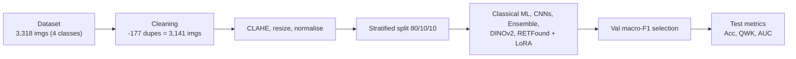

# Four-Class Retinopathy of Prematurity Staging from Fundus Images: A Comparison of Classical Machine Learning, CNNs and LoRA-Adapted Retinal Foundation Models

**Authors:** Praharsh Nagpure, Pravar Rangnekar, Rutuja Bait, and Yash Shengale
**Affiliation:** Department of Automation and Robotics, Vivekanand Education Society's Institute of Technology (VESIT), Chembur, Mumbai, India; University of Mumbai
**Supervisor:** Mrs. Amudha Senthilkumar

---

## Abstract

Retinopathy of Prematurity (ROP) is a vascular disorder of the developing retina in premature infants, and accurate staging of retinal fundus images is central to screening. This paper presents an experimental comparison of three families of models for four-class ROP classification (Normal, Stage 1, Stage 2, Stage 3): classical machine learning on handcrafted features, ImageNet-pretrained convolutional neural networks (CNNs), and a retinal foundation model (RETFound-DINOv2) adapted with Low-Rank Adaptation (LoRA). From an initial pool of 3,318 images, 177 exact duplicates were removed to leave 3,141 images, which were enhanced with Contrast Limited Adaptive Histogram Equalization (CLAHE) and divided by one fixed stratified split (80/10/10). Model selection used validation macro-F1, and held-out performance was reported using accuracy, balanced accuracy, macro-F1, Quadratic Weighted Kappa (QWK) and one-vs-rest AUC. ResNeSt50d achieved the highest test accuracy (83.5%, QWK 0.898), while RETFound with LoRA applied to attention and MLP layers reached 82.9% accuracy and QWK 0.897 using only 6.3M trainable parameters. With a 315-image test set, the difference between the two is well inside sampling uncertainty. Because evaluation used a single split and no external cohort, the findings establish feasibility rather than clinical readiness.

**Index Terms:** Retinopathy of Prematurity, retinal image classification, convolutional neural networks, RETFound, DINOv2, LoRA, CLAHE, medical image analysis.

---

## Contents

1. [Introduction](#i-introduction)
2. [Related Work](#ii-related-work)
3. [Dataset and Methodology](#iii-dataset-and-methodology)
4. [Implementation](#iv-implementation)
5. [Results](#v-results)
6. [Discussion](#vi-discussion)
7. [Conclusion and Future Work](#vii-conclusion-and-future-work)
8. [Acknowledgment](#acknowledgment)
9. [References](#references)

---

## I. Introduction

Retinopathy of Prematurity (ROP) is a retinal vascular disorder that mainly affects premature infants as a result of abnormal development of retinal blood vessels. If severe disease is not identified and managed appropriately, it can lead to permanent visual impairment [1]. Screening relies on examining retinal fundus images for vascular abnormalities and judging their severity, which demands specialised expertise. Disagreement between expert graders is a recognised difficulty in ROP diagnosis, and image quality further affects both manual and automated assessment [2], [3].

Machine learning (ML) and deep learning have therefore been investigated for automated ROP analysis. Convolutional neural networks (CNNs) have been applied to ROP detection, Plus-disease identification and severity assessment [3]-[7], and systematic reviews summarise rapid growth in this area [8]-[10]. More recently, retinal foundation models pretrained on large unlabelled fundus collections have emerged as an alternative to ImageNet-pretrained backbones [15], and parameter-efficient adaptation such as LoRA [18] makes it practical to fine-tune very large vision transformers on modest hardware.

Most published ROP studies address isolated tasks such as presence of disease or Plus disease, so their results are not directly comparable with full stage classification [3]. This work addresses that gap on a restricted but clinically meaningful task: four-class staging (Normal, Stage 1, Stage 2, Stage 3) under one common data split and one common set of metrics. The contributions are:

- A reproducible pipeline covering duplicate removal, CLAHE preprocessing, stratified splitting and validation-based model selection.
- A head-to-head comparison of classical handcrafted-feature classifiers, six ImageNet-pretrained CNNs, a top-three CNN ensemble, a fully fine-tuned DINOv2 ViT-B/14 and RETFound-DINOv2 with LoRA.
- A one-change-at-a-time sweep of LoRA placement, rank, learning rate, token pooling and drop-path, showing that adapting the MLP layers and using a learning rate of 6 x 10^-4 gave the best validation macro-F1.
- An explicit discussion of statistical uncertainty and the limits of a single-split protocol.

The rest of the paper is organised as follows. Section II reviews related work, Section III describes the dataset and methodology, Section IV gives implementation details, Section V presents results, Section VI discusses them and their limitations, and Section VII concludes.

---

## II. Related Work

### A. Clinical Background: ROP Stages

ROP is graded by the location, extent and appearance of abnormal vascular development at the boundary between vascularised and avascular retina. In the international classification, Stage 1 is a thin demarcation line, Stage 2 a raised ridge, and Stage 3 extraretinal fibrovascular proliferation growing from the ridge into the vitreous; Stages 4 and 5 denote partial and total retinal detachment, and aggressive posterior ROP (AP-ROP) is a rapidly progressing form in the posterior retina. The four classes used here (Normal and Stages 1-3) therefore cover the early-to-intermediate spectrum in which timely detection is most actionable, but exclude detachment and AP-ROP. Because the stages form an ordered scale, errors between adjacent stages are less severe than errors that skip a stage, motivating ordinal agreement metrics such as QWK [2].

### B. Conventional and Classical ML Approaches

Early computer-assisted ROP analysis focused on retinal vasculature, since vascular development and abnormality underpin ROP evaluation [1]. Digital imaging systems such as RetCam were introduced to document retinal appearance and support screening [11], [12]. Classical ML approaches derive handcrafted descriptors, such as vascular, texture and intensity features, and pass them to classifiers such as support vector machines and tree ensembles. Their performance depends strongly on feature design, data quality and the evaluation protocol.

### C. Deep Learning for ROP

Deep learning removes manual feature design. Huang et al. compared several ImageNet-pretrained architectures through transfer learning for ROP detection and severity classification, with VGG19 reporting 96% and 98.82% accuracy on the respective tasks, using images from 210 infants [3]. Brown et al. used deep CNNs to diagnose Plus disease [4], and Wang et al. and Hu et al. developed networks for ROP screening and analysis [5], [6]. Scruggs et al. review AI-based ROP diagnosis and highlight clinical and technical challenges for deployment [2]. High accuracies are frequently reported on small, single-centre cohorts, so generalisation requires care.

### D. Foundation Models and Datasets

Vision Transformers (ViT) model long-range relations between image patches [17]. DINOv2 provides strong self-supervised visual features [16], and RETFound pretrains a ViT-Large on retinal images to support downstream disease detection [15]. Comparative studies of EfficientNet, Vision Transformers and RETFound on retinal classification have recently appeared [14]. On the data side, Chen et al. released ROP-VL, containing 2,020 fundus photographs from 1,116 infants with clinical text, and proposed a vision-language model reaching 94.26% accuracy and Kappa of 91.40%; they note limited representation of advanced categories and the single-centre origin of the data [13].

### E. Summary of Selected Studies

Table I summarises representative studies. Reported figures come from different tasks, datasets and protocols and must not be compared numerically with the present four-class results.

**Table I. Representative ROP studies (reported values not directly comparable)**

| Ref. | Method | Reported result | Limitation |
|---|---|---|---|
| [3] | Transfer learning, five pretrained CNNs; ROP detection | VGG19: 96% acc. | 210 infants; generalisation unclear |
| [3] | Deep-learning severity classification | VGG19: 98.82% acc. | Study-specific data |
| [13] | ROP-VL dataset and vision-language EK-ROPNet | 94.26% acc., Kappa 91.40% | Single centre; few advanced cases |
| [2] | Review of AI for ROP diagnosis | n/a | Clinical/technical deployment hurdles |
| [1] | Narrative review of screening and management | n/a | Screening challenges in developing economies |

### F. Gap

Existing work mainly targets detection or Plus disease and often evaluates on one cohort. What is less documented is a controlled comparison of classical features, ImageNet CNNs and a retinal foundation model for four-class staging using identical data, split and metrics. This paper provides that comparison.

---

## III. Dataset and Methodology

### A. Dataset and Cleaning

Retinal fundus images were assembled from two public sources: a ROP fundus dataset released on Figshare (Zhao et al., 2024; 1,438 images) and ROP-VL [13] (1,880 images), giving 3,318 images in four classes. The data were checked for corrupt files and exact duplicates. No corrupt images were found; 177 exact duplicates were removed, leaving 3,141 images (Table III).

Table II gives the composition before cleaning. The two sources differ markedly in class balance: Normal images make up 43% of the Figshare data but only 16% of ROP-VL, whereas Stage 3 makes up 17% versus 35%. Such source-dependent class priors, together with likely differences in camera and acquisition conditions, mean that a model could exploit source-specific appearance as a shortcut; this is one reason the absence of source-held-out evaluation matters (Section VI).

The 177 removed duplicates were distributed as 57 Normal, 17 Stage 1, 37 Stage 2 and 66 Stage 3 images. Only exact duplicates were detected; visually near-identical images (for example, successive frames of the same eye) would not be caught by this check.

**Table II. Image counts per source before cleaning**

| Source | Normal | St. 1 | St. 2 | St. 3 | Total |
|---|---|---|---|---|---|
| Figshare (2024) | 623 | 236 | 338 | 241 | 1438 |
| ROP-VL (2026) | 293 | 425 | 513 | 649 | 1880 |
| **Total** | 916 | 661 | 851 | 890 | 3318 |

**Table III. Class distribution after cleaning and split**

| Split | Normal | St. 1 | St. 2 | St. 3 | Total |
|---|---|---|---|---|---|
| Train | 687 | 515 | 651 | 659 | 2512 |
| Validation | 86 | 65 | 81 | 82 | 314 |
| Test | 86 | 64 | 82 | 83 | 315 |
| **Total** | 859 | 644 | 814 | 824 | 3141 |

### B. Preprocessing

Contrast Limited Adaptive Histogram Equalization (CLAHE) [19] was applied to enhance local contrast. CLAHE divides the image into small tiles, equalises the histogram of each tile and clips the histogram at a limit before equalisation so that noise in nearly uniform regions is not over-amplified; neighbouring tiles are blended by bilinear interpolation to avoid visible seams. Applied to the lightness channel, it makes faint vascular ridges and demarcation lines more visible in under- or unevenly illuminated fundus photographs without distorting colour, which matters because several handcrafted features are colour based. Images were stored at 256 x 256 pixels and fed to the networks at approximately 224 x 224 after normalisation. For the classical track, black borders were additionally cropped using a grey threshold. A separate 320-pixel copy was prepared for a planned 280-pixel input experiment, which did not finish and is excluded from the results.

### C. Experimental Protocol

The cleaned set was divided once into approximately 80% training, 10% validation and 10% test data using a stratified split (seed 42), and the identical split was reused for every model (Table III). Model selection used validation macro-F1 only; the test set was used for reporting. Fig. 1 summarises the pipeline.



*Fig. 1. Overall experimental pipeline used for all three model families.*

The procedure for every model m can be stated compactly.

1. Remove exact duplicates and build the stratified split once.
2. Apply CLAHE, resize and normalise.
3. Train m on the training set.
4. Compute validation macro-F1 for m and, for sweeps, keep the configuration with the highest value.
5. Evaluate only the selected configurations on the test set and report accuracy, balanced accuracy, macro-F1, QWK and AUC.

Fixing the split and the selection rule in advance ensures that the comparison between model families is not influenced by differences in data handling.

### D. Model Families

#### 1. Classical ML

The classical track tests whether hand-designed descriptors capture stage-specific appearance. The descriptors target different cues.

- **Colour statistics** (channel means and standard deviations) capture global hue and brightness shifts.
- **LBP** (Local Binary Pattern) encodes local micro-texture by thresholding each pixel's neighbours against the centre pixel.
- **GLCM** (Gray-Level Co-occurrence Matrix) statistics such as contrast, homogeneity, energy and correlation describe how often pairs of grey levels co-occur at a given offset.
- **HOG** (Histogram of Oriented Gradients) summarises the distribution of local edge orientations, which responds to ridges and vessel boundaries.
- **Frangi filter** responds to tubular structures using the eigenvalues $\lambda_1, \lambda_2$ of the Hessian at scale $\sigma$:

$$V(\sigma) = \exp\left(-\frac{R_B^2}{2\beta^2}\right)\left(1 - \exp\left(-\frac{S^2}{2c^2}\right)\right) \tag{1}$$

with $R_B = |\lambda_1|/|\lambda_2|$ and $S = \sqrt{\lambda_1^2 + \lambda_2^2}$, so that elongated bright or dark structures such as vessels yield a high vesselness response.

The resulting colour, LBP, GLCM, HOG and Frangi vessel features were concatenated and supplied to SVM, LightGBM, CatBoost, ExtraTrees, XGBoost and Random Forest classifiers.

#### 2. CNNs

Six ImageNet-pretrained CNNs were fine-tuned: ResNeSt50d [20], DenseNet121 [21], EfficientNet-B2 [22], ResNet50 [23], MobileNetV3-Large [24] and ConvNeXt-Tiny [25], using the timm library. A soft ensemble of the three architectures with highest validation F1 (EfficientNet-B2, ResNet50, DenseNet121) was also built.

#### 3. Foundation models

A Vision Transformer splits an image into non-overlapping patches (here 14 x 14 pixels), embeds each patch as a token, prepends a class token and processes the sequence with stacked blocks of multi-head self-attention and MLP layers [17]. Self-attention computes

$$\mathrm{Attn}(Q, K, V) = \mathrm{softmax}\left(\frac{QK^{\top}}{\sqrt{d_k}}\right)V \tag{2}$$

so every patch can attend to every other patch, which allows relationships between distant retinal regions (for example optic disc, vessels and peripheral ridge) to be modelled. The class token, or a pooled combination of class and patch tokens, is passed to a linear head for classification.

DINOv2 ViT-B/14 [16] was fully fine-tuned. RETFound-DINOv2 [15] uses a ViT-Large backbone (24 blocks, width 1024, about 304M parameters) pretrained on retinal images. Its checkpoint (`RETFound_dinov2_meh.pth`, key `teacher`) loaded 342 tensors with none missing or unexpected. The backbone was frozen and Low-Rank Adaptation (LoRA) [18] adapters plus a four-class head were trained. LoRA replaces an update of a frozen weight $W_0$ by $W = W_0 + BA$ with $B \in \mathbb{R}^{d \times r}$, $A \in \mathbb{R}^{r \times k}$ and rank $r \ll \min(d, k)$, so only $A$ and $B$ are learned.

*Fig. 2. LoRA: only the low-rank factors A (r x k) and B (d x r) are trained, while the pretrained weight W0 stays frozen; h = W0 x + B A x.*

#### 4. Parameter efficiency

Table IV lists the LoRA variants. Relative to the 305-316M total parameters, the trainable fraction is about 0.78% for attention-only LoRA, 2.04% for attention+MLP at r = 16 and 3.99% at r = 32. This is the main practical attraction of the approach: the same frozen backbone can serve several tasks, with each task storing only a few million adapter parameters.

**Table IV. RETFound-DINOv2 LoRA configurations**

| Variant | Layers | Placement | Rank | Trainable |
|---|---|---|---|---|
| Base | 48 | Attn | 16 | 2.37M |
| MLP | 96 | Attn+MLP | 16 | 6.30M |
| MLP r32 | 96 | Attn+MLP | 32 | 12.59M |
| V2 | 96 | Attn+MLP | 32 | 12.60M |

### E. LoRA Configuration Sweep

A one-change-at-a-time sweep, run as ten-epoch probes in two stages, varied:

1. learning rate (2 x 10^-4, 4 x 10^-4, 6 x 10^-4, 8 x 10^-4);
2. token pooling (class token versus concatenated class and patch tokens);
3. adapter placement (attention only, 48 LoRA layers, versus attention+MLP, 96 layers);
4. rank (r = 16 or 32); and
5. drop-path.

A separate V2 run combined a learning rate of 10^-3, MLP adapters, pooled tokens and an exponential moving average (EMA). Table IV lists the configurations.

### F. Evaluation Metrics

With K = 4 classes, accuracy is the fraction of correct predictions. Balanced accuracy is the mean per-class recall, $\frac{1}{K}\sum_{i=1}^{K} \mathrm{Recall}_i$, and macro-F1 is $\frac{1}{K}\sum_{i=1}^{K} F1_i$ with $F1_i = 2P_iR_i/(P_i + R_i)$. Because stages are ordered, Quadratic Weighted Kappa (QWK) is also reported:

$$\mathrm{QWK} = 1 - \frac{\sum_{i,j} w_{ij} O_{ij}}{\sum_{i,j} w_{ij} E_{ij}}, \qquad w_{ij} = \frac{(i-j)^2}{(K-1)^2} \tag{3}$$

where $O$ and $E$ are the observed and expected confusion matrices. AUC was computed one-vs-rest, evaluating each class against the other three using the predicted class probability, and macro-averaged. Unlike accuracy, AUC summarises ranking quality over all decision thresholds and is therefore insensitive to the argmax rule used for the final prediction.

---

## IV. Implementation

Table V lists the hardware and software environment. Experiments ran on a single NVIDIA RTX 4050 GPU (6 GB VRAM) with bfloat16 mixed precision, using Python, PyTorch, CUDA, timm, scikit-learn, OpenCV and pandas. The output layer has four units; class probabilities are obtained by softmax and the prediction by argmax.

**Table V. Hardware and software environment**

| Item | Configuration |
|---|---|
| GPU / memory | NVIDIA RTX 4050 / 6 GB |
| Precision | bfloat16 mixed precision |
| Python / PyTorch / CUDA | 3.14 / 2.14.1 / 12.6 |
| timm / scikit-learn | 1.0.31 / 1.9.1 |
| OpenCV / pandas | 5.0 / 3.1 |
| Pretrained checkpoint | RETFound_dinov2_meh.pth |
| Checkpoint loading | 342 tensors; 0 missing; 0 unexpected |

The first LoRA run was configured for up to 30 epochs and stopped at epoch 20; V2 was configured for up to 50 epochs and also stopped at epoch 20; all sweep probes ran for 10 epochs. Table VI summarises the training schedules.

**Table VI. Training schedules of the RETFound-DINOv2 runs**

| Run | Max epochs | Learning rate | Stopped at |
|---|---|---|---|
| First LoRA run | 30 | 4 x 10^-4 | Epoch 20 |
| V2 | 50 | 1 x 10^-3 | Epoch 20 |
| Probes / final sweep | 10 | 2-8 x 10^-4 | Epoch 10 |

Typical epoch times were about 92 s (attention-only LoRA), 115 s (attention+MLP) and 120 s (V2), with some runs taking 300-400 s per epoch. The classical track used the same cleaned images after black-border cropping and was trained and evaluated on the same split. CNN backbones were initialised from ImageNet weights, the final classifier layer was replaced by a four-way layer, and all layers were fine-tuned; the ensemble averaged the class probabilities of its three members. For RETFound, the teacher weights of the self-supervised checkpoint were loaded into a ViT-Large encoder (patch size 14, 24 transformer blocks), LoRA modules were inserted into the query, key, value and projection layers (and, in MLP variants, the fully connected layers), and layer-wise learning-rate decay was not used.

Batch size, optimiser, weight decay, LoRA alpha and dropout, augmentation details and loss function were not preserved in the experiment logs and are therefore not reported; this is a reproducibility limitation noted in Section VI.

---

## V. Results

### A. CNNs, Ensemble and Foundation Models

Table VII reports test performance on the 315 held-out images. ResNeSt50d achieved the highest accuracy (0.835), balanced accuracy (0.827), macro-F1 (0.828) and QWK (0.898). RETFound with LoRA (`mlp_lr6e4`) was within 0.6 accuracy points (0.829) and matched it on QWK (0.897), with an AUC of 0.958 against 0.956. The top-three ensemble gave the best AUC (0.959) and the highest validation F1 among CNN-based systems (0.856), but not the best test accuracy (0.825). Fully fine-tuned DINOv2 ViT-B/14 reached 79.4% accuracy. ConvNeXt-Tiny performed poorly (53.0%), which we attribute to unsuccessful optimisation under the common schedule rather than to an inherent limitation of the architecture; this was not investigated further.

**Table VII. Test performance on the fixed 315-image test set (models selected by validation macro-F1)**

| Model | Val F1 | Accuracy | Bal. Acc. | Macro-F1 | QWK | AUC |
|---|---|---|---|---|---|---|
| ResNeSt50d | 0.821 | **0.835** | **0.827** | **0.828** | **0.898** | 0.956 |
| RETFound LoRA (`mlp_lr6e4`) | 0.839 | 0.829 | 0.825 | 0.823 | 0.897 | 0.958 |
| Ensemble top-3 | **0.856** | 0.825 | 0.821 | 0.818 | 0.881 | **0.959** |
| DenseNet121 | 0.822 | 0.822 | 0.816 | 0.815 | 0.880 | 0.942 |
| EfficientNet-B2 | 0.832 | 0.819 | 0.812 | 0.811 | 0.884 | 0.943 |
| ResNet50 | 0.827 | 0.810 | 0.802 | 0.800 | 0.860 | 0.951 |
| MobileNetV3-Large | 0.769 | 0.775 | 0.775 | 0.769 | 0.840 | 0.925 |
| DINOv2 ViT-B/14 (full FT) | n/r | 0.794 | n/r | n/r | n/r | n/r |
| ConvNeXt-Tiny | 0.491 | 0.530 | 0.546 | 0.520 | 0.497 | 0.821 |

*n/r: not reported.*

Test accuracy ranks the models as: ResNeSt50d 83.5, RETFound LoRA 82.9, Ensemble top-3 82.5, DenseNet121 82.2, EfficientNet-B2 81.9, ResNet50 81.0, DINOv2 ViT-B/14 79.4, MobileNetV3 77.5, ConvNeXt-Tiny 53.0 (Fig. 3, values also in Table VIII).

Accuracy and QWK fall close to a monotonic trend (Fig. 4). ResNeSt50d and RETFound lie in the top-right corner with nearly identical coordinates (accuracy 0.835 / QWK 0.898 and 0.829 / 0.897), while the ensemble, DenseNet121 and EfficientNet-B2 form a second group about 0.015-0.018 lower in QWK.

### B. Statistical Uncertainty

Because the test set holds only 315 images, point estimates are imprecise. Table VIII gives 95% Wilson intervals for accuracy computed from the number of correct predictions. The intervals of the top five models overlap almost completely, so their ranking is not statistically reliable. Only ConvNeXt-Tiny is clearly separated from the others; the intervals of DINOv2 ViT-B/14 and MobileNetV3-Large still overlap that of ResNeSt50d. Paired tests such as McNemar's test would be more sensitive, but they require per-image predictions that were not retained.

**Table VIII. Test accuracy with 95% Wilson intervals (n = 315)**

| Model | Correct | Accuracy (%) | 95% CI (%) |
|---|---|---|---|
| ResNeSt50d | 263 | 83.5 | 79.0-87.2 |
| RETFound LoRA | 261 | 82.9 | 78.4-86.7 |
| Ensemble top-3 | 260 | 82.5 | 77.9-86.3 |
| DenseNet121 | 259 | 82.2 | 77.6-86.0 |
| EfficientNet-B2 | 258 | 81.9 | 77.3-85.8 |
| ResNet50 | 255 | 81.0 | 76.3-84.9 |
| DINOv2 ViT-B/14 | 250 | 79.4 | 74.6-83.5 |
| MobileNetV3-L | 244 | 77.5 | 72.6-81.8 |
| ConvNeXt-Tiny | 167 | 53.0 | 47.5-58.4 |

### C. Computational Cost

Table IX summarises the recorded epoch times on the 6 GB laptop-class GPU. Moving from attention-only to attention+MLP adapters increased epoch time by roughly 25% (92 s to 115 s), and V2 was slightly slower at about 120 s. Total GPU-hours, energy use and monetary cost were not recorded. Even so, the experiments show that a 304M-parameter retinal foundation model can be adapted on a consumer-grade GPU with 6 GB of memory when only adapters and the head are trained under bfloat16 precision.

**Table IX. Recorded epoch times (RTX 4050, bfloat16)**

| Configuration | Time per epoch |
|---|---|
| Attention-only LoRA | ~92 s |
| Attention+MLP LoRA | ~115 s |
| V2 (attn+MLP, EMA) | ~120 s |
| Other recorded runs | ~300-400 s |

### D. LoRA Sweep

Table X reports the RETFound-DINOv2 runs (Fig. 6 plots the validation macro-F1 column). Extending adapters from attention only to attention+MLP raised validation macro-F1 from 0.789 to 0.832 in the probe comparison, and the best configuration, `mlp_lr6e4`, reached 0.839. Increasing the rank to 32 or adding drop-path gave no clear gain. The V2 run, with a learning rate of 10^-3, was clearly worse (validation F1 0.721, test accuracy 0.705), showing sensitivity to learning rate. For attention-only adapters, learning rate behaved non-monotonically: test accuracy was 0.765 at 2 x 10^-4, 0.787 at 4 x 10^-4 and 0.768 at 8 x 10^-4, although validation F1 rose to 0.815 at the highest rate. This disagreement between validation and test ordering on a small split is a further sign of noise in the sweep. Longer training also gave only a small change: the first 20-epoch base run reached validation F1 0.798, compared with 0.789 for the 10-epoch base probe. Two nominally identical MLP runs differed in test accuracy (0.816 and 0.797), which gives a direct, if informal, estimate of run-to-run variability of roughly two accuracy points.

More trainable parameters did not simply mean better validation performance (Fig. 5): the rank-32 variant (12.59M) scored below the rank-16 MLP variants, and the best model used 6.30M parameters.

**Table X. RETFound-DINOv2 LoRA sweep results**

| Run | Ep. | Val F1 | Acc. | QWK | AUC |
|---|---|---|---|---|---|
| First run (base) | 20 | 0.798 | 0.794 | 0.861 | 0.943 |
| V2 | 20 | 0.721 | 0.705 | 0.819 | 0.913 |
| Probe base | 10 | 0.789 | 0.787 | 0.857 | 0.943 |
| Probe lr2e-4 | 10 | 0.792 | 0.765 | 0.863 | 0.936 |
| Probe lr8e-4 | 10 | 0.815 | 0.768 | 0.855 | 0.943 |
| Probe cat pooling | 10 | 0.800 | 0.781 | 0.852 | 0.947 |
| Probe MLP | 10 | 0.832 | 0.816 | 0.876 | 0.950 |
| MLP rerun | 10 | 0.803 | 0.797 | 0.862 | 0.947 |
| MLP r32 | 10 | 0.808 | 0.816 | 0.867 | 0.950 |
| MLP dp1 | 10 | 0.827 | 0.797 | 0.861 | 0.951 |
| **MLP lr6e-4** | 10 | **0.839** | **0.829** | **0.897** | **0.958** |

### E. Comparison of Model Families

Table XI contrasts the three families. The handcrafted-feature classifiers were evaluated, but their final numerical results were not retained in the experiment summary and are therefore not tabulated; consequently no quantitative claim about their gap to deep models is made here.

**Table XI. Comparison of model families**

| | Classical ML | CNN | Foundation |
|---|---|---|---|
| Input | Handcrafted features | CLAHE image | CLAHE image |
| Pretraining | None | ImageNet | Retinal images |
| Trainable params | Small | ~2-25M | 2.4-12.6M (LoRA) |
| Best accuracy | n/r | 83.5% | 82.9% |
| Best QWK | n/r | 0.898 | 0.897 |
| Training cost | Lowest | Medium | Highest |
| Main weakness | Feature limits | Config. variability | LR sensitivity |

*n/r: not reported.*

---

## VI. Discussion

### A. Interpretation

The central finding is that a CNN and a LoRA-adapted retinal foundation model performed essentially equally. A binomial approximation for an accuracy near 0.83 on n = 315 images gives a standard error of about 2.1 points and a 95% interval of roughly +/-4 points, so the 0.6-point gap between ResNeSt50d and RETFound is not distinguishable from noise, and the observed 2-point variation between repeated MLP runs is of the same order. The results therefore do not support declaring either family superior. The practical difference is cost and configuration burden: the LoRA model trains at most 12.6M parameters on a frozen 304M-parameter backbone, but needed a sweep to find a stable learning rate, while the CNNs were simpler to train but showed large spread across architectures (53.0%-83.5%).

QWK values near 0.90 for the leading models indicate that most errors fall between adjacent stages, which is the clinically less severe error type for an ordered scale. That the best QWK and best accuracy coincide for ResNeSt50d and nearly coincide for RETFound suggests that the models learned stage ordering rather than separable but unordered clusters.

### B. Engineering Trade-offs

Adapting MLP layers in addition to attention gave the largest improvement in validation F1 in the sweep, at the cost of more trainable parameters (6.30M versus 2.37M) and about 25% longer epochs. Larger rank did not help, which suggests rank 16 already has enough capacity for this dataset size. Learning rate was the most sensitive hyperparameter: 6 x 10^-4 was best, while 10^-3 with EMA (V2) was clearly worse. Selection by validation macro-F1 over a sweep of eleven configurations on a 314-image validation set also carries a mild selection bias, so the reported test accuracy of the chosen configuration may be slightly optimistic.

### C. Summary of Findings

The experiments support five observations.

1. A well-tuned ImageNet CNN (ResNeSt50d) and a LoRA-adapted retinal foundation model reach statistically indistinguishable performance on this split.
2. Adapting MLP layers as well as attention improves validation macro-F1 over attention-only adaptation.
3. Larger adapter rank and drop-path give no clear benefit.
4. Performance is sensitive to learning rate and to architecture choice, from 53.0% to 83.5% across CNNs.
5. A 304M-parameter retinal foundation model can be adapted on a 6 GB GPU with 2.4-12.6M trainable parameters.

### D. Relation to Prior Work

Several earlier studies report accuracies above 94% [3], [13], higher than the 83.5% reported here. These numbers should not be read as evidence that the present models are inferior. The earlier results concern different tasks (detection or severity grouping rather than four-stage classification), different label spaces and different cohorts, and, as the original authors note, they depend on the specific dataset and experimental conditions [3], [13]. Distinguishing adjacent stages from a single fundus image is intrinsically harder than detecting the presence of disease, because stage boundaries are gradual and graders themselves disagree [2]. The contribution of this work is a transparent, like-for-like comparison of model families under one protocol, not a claim of state-of-the-art accuracy.

Regarding foundation models, RETFound was designed to generalise across retinal disease tasks with limited labels [15]. In our results the retinal-pretrained model matched but did not exceed the best ImageNet CNN. A plausible explanation, which these experiments cannot confirm, is that with about 2.5k training images the fine-tuning signal is sufficient for a well-regularised CNN, and that most of the benefit of retinal pretraining would appear in lower-data regimes or under distribution shift, both of which were outside the present protocol.

### E. Metric Behaviour

The leading models differ little in accuracy, balanced accuracy and macro-F1, which move together (for ResNeSt50d: 0.835, 0.827, 0.828). This is expected because the test classes are nearly balanced (64-86 images each), so accuracy and balanced accuracy cannot diverge much. AUC and QWK behave differently: the ensemble has the best AUC (0.959) but a lower QWK (0.881) than ResNeSt50d (0.898), which indicates that better probability ranking of classes does not automatically translate into fewer stage-skipping errors at the argmax decision. For screening use, the ordinal structure suggests that thresholds or ordinal losses could be tuned to penalise distant-stage errors.

### F. Implications for Deployment

For a screening workflow, the useful outputs are not only a predicted stage but also a confidence estimate and a recommendation to refer uncertain cases to a clinician. The present work did not evaluate calibration, so predicted probabilities should not yet be interpreted as reliable confidence. Image acquisition also differs between clinics, and the preprocessing used here (CLAHE, cropping) may not compensate for changes in device, field of view or illumination. A practical next stage is a prospective, multi-centre evaluation with clinician-graded labels and analysis of failure cases, ideally including inter-grader agreement as an upper reference for model agreement.

### G. Ethical and Data Considerations

The study used publicly released datasets, and no new patient data were collected. Fundus images of infants are sensitive medical data, so any extension to hospital data requires ethics approval, informed consent or a waiver, de-identification and compliance with applicable data-protection rules. Predictions from a model trained on a research cohort can be wrong for under-represented groups or devices, and automation bias, where a clinician over-trusts the output, is a recognised risk. The model should therefore only be used as decision support under clinician oversight, and not as an independent diagnostic tool.

### H. Threats to Validity

- **Internal:** model selection on a small validation set across many configurations may favour a lucky run; the observed gap of about two accuracy points between two MLP runs illustrates this.
- **External:** both sources are public research datasets whose labelling process, camera types and patient populations may not match a target clinic.
- **Construct:** four-class staging is a simplification of clinical decision-making, which also involves zone, extent, Plus disease and treatment thresholds.
- **Reproducibility:** missing hyperparameters (Section IV) limit exact replication, although the architectures, checkpoint, split sizes and metrics are specified.

### I. Limitations

- **Single split, single run.** One stratified split was used, with no repeated cross-validation or multiple seeds for the final models, so confidence intervals and significance tests were not computed from repeats.
- **No external validation.** Both data sources were merged before splitting. The reported performance therefore does not demonstrate generalisation to new hospitals, cameras or populations. In addition, if images from the same infant exist in more than one split, performance can be overestimated; infant-level separation was not available for this four-class split and is an important next step.
- **Restricted label space.** Only Normal and Stages 1-3 were used. Stage 4/5 and Aggressive Posterior ROP, which are clinically critical, were not included.
- **Incomplete records.** Classical ML results, several training hyperparameters and a 280-pixel resolution experiment are missing or unfinished. Calibration and class-wise error analysis were not performed.
- **Clinical safety.** No clinical safety, robustness or fault-injection testing was performed. The system is a research prototype and must not be used as an independent diagnostic tool.

### J. Reproducibility Status

Table XII separates what is specified from what was not retained in the experiment records. Releasing the code, the split indices and the per-image predictions would close most of these gaps and would also enable the paired statistical tests discussed above.

**Table XII. Reproducibility status**

| Specified | Not retained |
|---|---|
| Dataset sizes, per-class counts, split sizes, split seed (42) | Batch size, optimiser, weight decay |
| Preprocessing (CLAHE, 256/224 px) | Augmentation settings, loss function |
| Model list, checkpoint, LoRA ranks/placement | LoRA alpha/dropout, early-stopping patience |
| Epoch budgets, learning rates | Exact drop-path value (dp1) |
| Metrics and selection rule | Classical ML scores, per-image predictions |

---

## VII. Conclusion and Future Work

This paper compared classical ML, ImageNet CNNs and LoRA-adapted RETFound-DINOv2 for four-class ROP staging on 3,141 cleaned fundus images under one common protocol. ResNeSt50d achieved the highest test accuracy (83.5%) and QWK (0.898); RETFound with attention+MLP LoRA at a learning rate of 6 x 10^-4 reached 82.9% and 0.897 while training only 6.3M parameters. Given the test-set size, the two should be regarded as comparable. The work shows that automated four-class ROP staging is feasible in this experimental setting; it does not establish clinical readiness.

Future work includes, first, infant-grouped five-fold cross-validation with at least two random seeds, so that images of the same infant never appear in both training and validation data, and so that mean and spread of each metric can be reported. Second, leave-one-source-out evaluation across the two data sources and, ultimately, an independent hospital cohort should quantify domain shift. Third, the label space should be extended to Stage 4/5 and AP-ROP. Further directions are calibration analysis, completion of the classical-ML and higher-resolution experiments, statistical comparison of models (for example McNemar's test and bootstrap confidence intervals), and an explainability study to verify that predictions rely on clinically relevant retinal regions.

---

## Acknowledgment

The authors thank their supervisor, Mrs. Amudha Senthilkumar, and the Department of Automation and Robotics, VESIT, for guidance and support.

---

## References

```text
[1]  P. K. Shah, V. Prabhu, S. S. Karandikar, R. Ranjan, V. Narendran, and N. Kalpana,
     "Retinopathy of prematurity: Past, present and future," World J. Clin. Pediatr., vol. 5,
     no. 1, pp. 35-46, 2016.

[2]  B. A. Scruggs, R. V. P. Chan, J. Kalpathy-Cramer, M. F. Chiang, and J. P. Campbell,
     "Artificial intelligence in retinopathy of prematurity diagnosis," Transl. Vis. Sci.
     Technol., vol. 9, no. 2, Art. no. 5, 2020.

[3]  Y.-P. Huang, S. Vadloori, H.-C. Chu, E. Y.-C. Kang, W.-C. Wu, S. Kusaka, and
     Y. Fukushima, "Deep learning models for automated diagnosis of retinopathy of prematurity
     in preterm infants," Electronics, vol. 9, no. 9, Art. no. 1444, 2020.

[4]  J. M. Brown et al., "Automated diagnosis of Plus disease in retinopathy of prematurity
     using deep convolutional neural networks," JAMA Ophthalmol., 2018.

[5]  J. Wang et al., "Automated retinopathy of prematurity screening using deep neural
     networks," EBioMedicine, vol. 35, pp. 361-368, 2018.

[6]  J. Hu, Y. Chen, J. Zhong, R. Ju, and Z. Yi, "Automated analysis for retinopathy of
     prematurity by deep neural networks," IEEE Trans. Med. Imag., vol. 38, no. 1,
     pp. 269-279, 2019.

[7]  Y. Tong, W. Lu, Q.-Q. Deng, C. Chen, and Y. Shen, "Automated identification of
     retinopathy of prematurity by image-based deep learning," Eye Vis., vol. 7, Art. no. 40,
     2020.

[8]  A. Ramanathan, S. E. Athikarisamy, and G. C. Lam, "Artificial intelligence for the
     diagnosis of retinopathy of prematurity: A systematic review of current algorithms,"
     Eye, vol. 37, pp. 2518-2526, 2023.

[9]  A. Nikolaidou et al., "Deep learning algorithms for the diagnosis and staging of
     retinopathy of prematurity: A systematic review and meta-analysis," Cureus, 2026.

[10] A. Jafarizadeh et al., "Current and future roles of artificial intelligence in
     retinopathy of prematurity," Artif. Intell. Rev., vol. 58, Art. no. 188, 2025.

[11] C. Wu, R. A. Petersen, and D. K. VanderVeen, "RetCam imaging for retinopathy of
     prematurity screening," J. AAPOS, vol. 10, no. 2, pp. 107-111, 2006.

[12] Y. Bao et al., "Current application of digital diagnosing systems for retinopathy of
     prematurity," Comput. Methods Programs Biomed., Art. no. 105871, 2021.

[13] S. Chen et al., "ROP-VL: An open dataset integrating fundus photograph and clinical
     knowledge for retinopathy of prematurity," Sci. Data, 2026.

[14] M. Alutaibi and M. Alazmi, "Comparative evaluation of EfficientNetB3, Vision
     Transformers, and RETFound for seven-category retinopathy fundus image classification,"
     Diagnostics, vol. 16, Art. no. 3109, 2026.

[15] Y. Zhou et al., "A foundation model for generalizable disease detection from retinal
     images," Nature, vol. 622, pp. 156-163, 2023.

[16] M. Oquab et al., "DINOv2: Learning robust visual features without supervision," Trans.
     Mach. Learn. Res., 2024.

[17] A. Dosovitskiy et al., "An image is worth 16x16 words: Transformers for image
     recognition at scale," in Proc. ICLR, 2021.

[18] E. J. Hu et al., "LoRA: Low-rank adaptation of large language models," in Proc. ICLR,
     2022.

[19] K. Zuiderveld, "Contrast limited adaptive histogram equalization," in Graphics Gems IV.
     San Diego, CA, USA: Academic Press, 1994, pp. 474-485.

[20] H. Zhang et al., "ResNeSt: Split-attention networks," in Proc. IEEE/CVF CVPR Workshops,
     2022, pp. 2736-2746.

[21] G. Huang, Z. Liu, L. van der Maaten, and K. Q. Weinberger, "Densely connected
     convolutional networks," in Proc. IEEE CVPR, 2017, pp. 4700-4708.

[22] M. Tan and Q. V. Le, "EfficientNet: Rethinking model scaling for convolutional neural
     networks," in Proc. ICML, 2019, pp. 6105-6114.

[23] K. He, X. Zhang, S. Ren, and J. Sun, "Deep residual learning for image recognition," in
     Proc. IEEE CVPR, 2016, pp. 770-778.

[24] A. Howard et al., "Searching for MobileNetV3," in Proc. IEEE/CVF ICCV, 2019,
     pp. 1314-1324.

[25] Z. Liu et al., "A ConvNet for the 2020s," in Proc. IEEE/CVF CVPR, 2022, pp. 11976-11986.
```